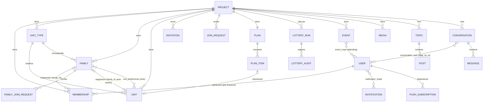
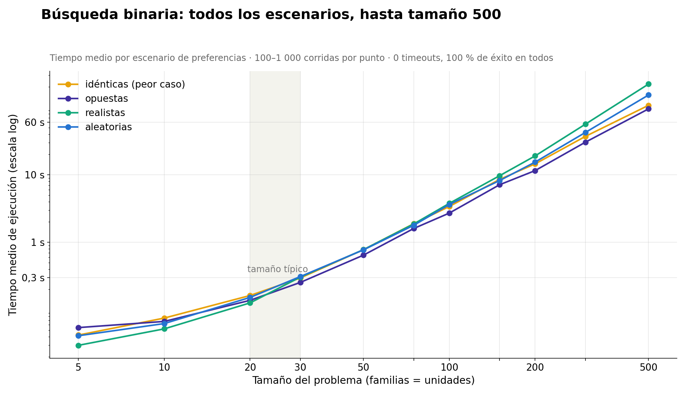
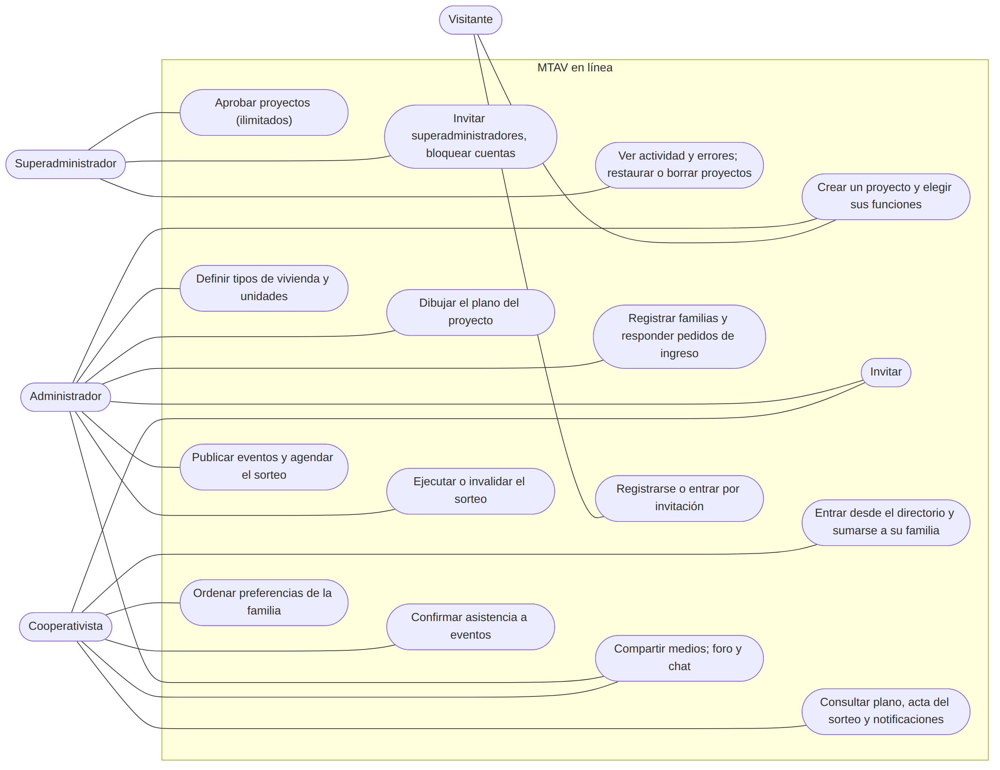
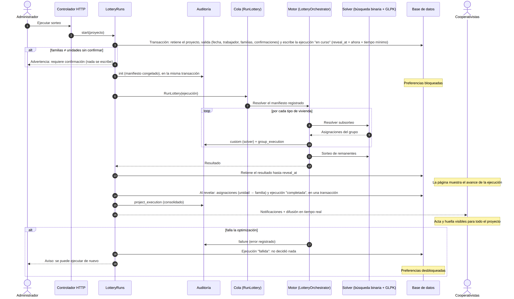

```{=openxml}
<w:p><w:r><w:br w:type="page"/></w:r></w:p>
```

# Apéndices {.unnumbered}

Los apéndices son material de referencia. No están pensados para leerse de principio a fin: cada uno amplía un tema que los Capítulos @cap-intro a @cap-conclusiones presentan de forma suficiente para comprender el trabajo. Un lector con interés particular en un tema —el modelo de datos, la formulación matemática, el análisis— encontrará aquí el detalle; quien no, puede omitirlos sin perder el hilo.

**Guía rápida:**

- **A — Modelo de datos y recursos JSON.** Por qué el esquema tiene la forma que tiene (derivación), diagrama entidad-relación completo y definiciones tabla por tabla, y los recursos JSON que exponen esos modelos al *frontend*.
- **B — Autenticación, roles y permisos.** Mecanismo de autenticación, registro, invitaciones y ciclo de la cuenta; matriz de qué puede hacer cada rol, por recurso y acción.
- **C — El sorteo: modelos, auditoría y rendimiento.** Modelos GMPL completos de la formulación del Capítulo @cap-sorteo, formato del registro de auditoría de cada ejecución, y los datos completos de los *benchmarks* de rendimiento.
- **D — Formato de datos del plano espacial** y arquitectura de sus componentes.
- **E — Pruebas y aseguramiento de calidad.**
- **F — Uso de IA en el proyecto.**
- **G — Análisis: casos de uso, requisitos y flujos.** Actores, casos de uso, requisitos funcionales y no funcionales, y el diagrama de secuencia del sorteo.
- **H — Manuales de usuario.** Dónde leer las guías por rol y las preguntas frecuentes, tal como las ve el usuario.
- **I — Herramientas de desarrollo y entornos (DX).** El comando `./mtav` y la composición de entornos Docker que abstraen la complejidad operativa para quien retome el proyecto.

---

## Apéndice A — Modelo de datos y recursos JSON {#ap-a}

### A.1 Del problema al esquema: por qué el modelo crece {#ap-a1}

La premisa de MTAV en línea es engañosamente simple: *"una aplicación para que las propias familias ingresen sus preferencias y se ejecute el sorteo"*. A primera vista no parece necesitar mucho más que una lista de familias y una lista de viviendas. Sin embargo, el modelo de datos real tiene más de treinta tablas. Esta sección deriva ese modelo paso a paso, mostrando cómo **cada entidad aparece obligada por una necesidad concreta**. Es el lugar donde vive, de forma cohesiva, la justificación completa del modelo; el resto del documento se apoya en esta derivación en lugar de repetirla.

**Punto de partida: preferencias.** El sorteo asigna viviendas a partir de las preferencias. Lo mínimo indispensable es, entonces, tres cosas: una **familia**, un conjunto de **unidades** (las viviendas concretas) y una forma de registrar cómo esa familia *ordena* esas unidades. Ese ordenamiento es una relación muchos-a-muchos entre familias y unidades con un dato extra —la posición en el ranking—, que en el esquema es la tabla `unit_preferences` con su columna [`rank`]{.cambio}. Aquí aparece ya una decisión de fondo: **el sujeto que recibe una vivienda es la familia, no la persona**. Una familia obtiene una única unidad.

**Una familia es varias personas: las pertenencias.** Una familia no es un único usuario: varias personas —integrantes de un mismo núcleo— pueden interactuar con la aplicación en su nombre. Hace falta entonces vincular personas con familias[. Como una misma persona puede participar en varios proyectos, con un rol distinto en cada uno, ese vínculo no está en la persona sino en su **pertenencia** a un proyecto (`Membership`): una fila por persona y proyecto, con la familia a la que se sumó (`family_id`, vacío mientras no lo haga) y si administra el proyecto (`is_admin`)]{.cambio}. Una familia tiene muchas pertenencias; una pertenencia está en una familia. Las preferencias, sin embargo, siguen siendo de la *familia*, no de cada persona: cualquier integrante las edita, pero el sujeto del sorteo es el núcleo familiar. [Nov. 2026: pertenencias por proyecto]{.rev #rev-n-a1}

**Todos se autentican: la tabla `users`.** Los cooperativistas inician sesión. Pero también lo hacen quienes configuran el proyecto (los administradores) y quienes operan la plataforma (los superadministradores). Todos comparten el mismo mecanismo de autenticación: correo y contraseña o una cuenta de Google, restablecimiento de clave, cambio de correo verificado. En lugar de tres tablas de autenticación paralelas, se unifican en una sola tabla **`users`**[, que no dice qué rol tiene la persona en ningún proyecto —eso lo dice cada pertenencia—; solo lleva los dos atributos que son de la cuenta y no de un proyecto: `is_superadmin`, la cuenta de soporte de la plataforma, e `is_owner`, la primera de ellas]{.cambio}. (Cómo se derivan los roles de estas dos tablas se trata más abajo, en A.3.)

**Todo pertenece a una cooperativa: los proyectos.** MTAV en línea sirve a muchas cooperativas a la vez. Cada familia, cada unidad, cada evento pertenece a un **proyecto** concreto (el emprendimiento de una cooperativa). Aparece así la entidad `Project`, y las familias y unidades pasan a pertenecer a un proyecto. Esta pertenencia no es solo organizativa: es la que permite que la aplicación aísle por completo los datos de una cooperativa de los de otra (el mecanismo de *scoping* por proyecto se detalla en §@sec-autorizacion).

**Alguien crea y gestiona todo esto: los administradores.** Las familias, las unidades y los eventos no se crean solos. Hace falta un **administrador** que configure el proyecto. [Es la misma tabla de pertenencias la que lo dice: un administrador puede gestionar varios proyectos y un proyecto puede tener varios administradores, y una pertenencia puede a la vez administrar y estar en una familia. Una sola vía de pertenencia persona–proyecto sirve a todos los roles.]{.cambio}

**Las unidades no son intercambiables: los tipos de vivienda.** Un apartamento de dos dormitorios y uno de tres no son comparables, y una familia a la que le corresponde uno de tres dormitorios solo debe seleccionar sus preferencias por unidades de tres dormitorios. Por eso cada unidad tiene un **tipo** (`UnitType`) y cada familia tiene asignado un tipo. Esto revela algo importante sobre el sorteo: el sorteo "global" de un proyecto es en realidad un conjunto de **subsorteos independientes, uno por tipo de vivienda**, en los que las familias de ese tipo compiten por las unidades de ese tipo. El tipo de vivienda no es un adorno descriptivo: es lo que particiona el problema. (La mecánica del sorteo por tipos y la redistribución de remanentes se tratan en §@sec-ejecucion.)

**El resultado: la asignación.** Terminado el sorteo, cada familia recibe una única unidad. Eso se registra en la propia unidad, mediante su `family_id`: una unidad pertenece (tras el sorteo) a una familia, y una familia tiene una unidad. Antes del sorteo ese vínculo es nulo. La asignación no es una tabla aparte: es este vínculo el que constituye la fuente de verdad del resultado.

**Y sigue creciendo.** Sobre esta espina dorsal —usuarios, proyectos, pertenencias, familias, tipos de vivienda, unidades y preferencias— se apoyan las demás piezas, cada una respondiendo a una necesidad igual de concreta: [cómo entra la gente (las **invitaciones** y los **pedidos** de ingreso a un proyecto o a una familia),]{.nuevo} los **eventos** y su confirmación de asistencia (asambleas, el propio sorteo), los **medios** (documentos e imágenes del proyecto), el **plano** espacial, [el **foro** y el **chat**,]{.nuevo} las **notificaciones** [y los dispositivos que las reciben]{.nuevo}, [las **ejecuciones** del sorteo y su]{.nuevo} **registro de auditoría**[, y los registros de la plataforma: la **actividad**, los **errores**, los **reportes** al equipo]{.nuevo}. Cada una se describe en su sección correspondiente.

Dos observaciones cierran la derivación:

- **Las preferencias son dinámicas.** El modelo permite que las unidades se agreguen o quiten y que las familias cambien de tipo. Por eso la tabla `unit_preferences` **no** es la fuente de verdad de las preferencias: la lista válida de preferencias de cada familia se resuelve en tiempo de ejecución, contemplando esos cambios (se detalla en §@sec-ejecucion). Esta flexibilidad es, ella misma, una consecuencia de haber modelado el problema con entidades separadas en lugar de una planilla rígida.
- **Las reglas de acceso surgen del propio modelo.** Que exista un administrador que crea, un cooperativista que solo ordena las preferencias de *su* familia y un superadministrador que supervisa no es una capa añadida a posteriori: es una lectura directa de las relaciones anteriores. Cómo se aplican esas reglas en cada capa se detalla en la Sección @sec-autorizacion.

En síntesis: la complejidad del modelo no es accidental ni ornamental. Cada tabla es la respuesta mínima a un requisito real que la premisa inicial —"que las familias ingresen sus preferencias"— trae implícito.

### A.2 Esquema relacional completo {#ap-a2}

[Sección reescrita (noviembre de 2026): el esquema es el de la reescritura, definido de nuevo desde cero]{.rev #rev-n-a2}

Esta sección documenta el esquema tal como lo definen las migraciones (`database/migrations/`), que son la fuente de verdad versionada de la estructura. Antes de las tablas, tres convenciones transversales que se repiten en todo el esquema:

- **Integridad referencial explícita.** Toda clave foránea declara qué ocurre al borrar el registro referenciado: `cascade` (el hijo se borra con el padre: las unidades de un proyecto no tienen sentido sin él), `restrict` (el borrado se impide: no puede desaparecer un tipo de vivienda que tiene familias) o `null` (el vínculo se limpia: si se elimina una cuenta, lo que aportó queda sin su nombre, no desaparece).
- **Unicidad *dentro del proyecto*.** Los identificadores son únicos por proyecto, no globalmente: dos cooperativas distintas pueden tener una unidad "A-101" o un tipo "2 dormitorios". Se implementa con claves únicas compuestas (`project_id` + `identifier`, `project_id` + `name`). Los nombres de proyectos y de familias, en cambio, pueden repetirse.
- **Archivo y marcas de tiempo.** Las entidades de dominio llevan `created_at`/`updated_at`, y las que vale la pena recuperar —proyectos, familias, eventos, medios, temas y mensajes del foro— llevan borrado suave (`deleted_at`; se detalla en A.4).

**Diagrama entidad-relación** (notación *crow's foot*; se omiten las tablas de infraestructura, las de los registros de la plataforma, las de la variante Open Lottery, las auxiliares —`support_invitations`, `family_people`, `platform_settings`, `reports`— y las columnas, definidas en las tablas siguientes):



*(Fuente del diagrama en `assets/er-diagram.mmd`, formato Mermaid; regenerar la imagen al cambiar el esquema.)*

**Cuentas y pertenencia.**

| Tabla | Propósito | Columnas y restricciones relevantes |
|---|---|---|
| `users` | Toda persona que se autentica | `email` (único), `email_public`, `new_email` (cambio de correo pendiente de verificación), `password`, `google_id` (único, opc.), `firstname`, y opcionales `lastname`, `phone`, `legal_id`, `about`, `avatar` y `locale`; `phone_public`, `is_superadmin`, `is_owner`; `email_verified_at`, `blocked_at`, `welcomed_at` |
| `memberships` | La parte de una persona en un proyecto | `user_id` + `project_id` (FKs cascade, par único), `family_id` (FK nullable, null al borrar), `is_admin` |
| `invitations` | Un enlace enviado a un proyecto, a una familia o como administrador | `project_id` (FK cascade), `family_id` (FK nullable cascade), `is_admin`, `email`, `firstname`/`lastname` (opc.), `token_hash` (único: solo el *hash* del enlace), `invited_by` (FK null al borrar), `expires_at`, `accepted_at` |
| `support_invitations` | Invitación a ser superadministrador | `email`, `token_hash` (único), `invited_by`, `expires_at`, `accepted_at` |
| `join_requests` | Pedido de ingreso a un proyecto desde el directorio | `project_id` + `user_id` (FKs cascade, par único), `declined_at` |
| `family_join_requests` | Pedido de ingreso a una familia | `project_id`, `family_id` + `user_id` (FKs cascade, par único), `declined_at` |
| `family_people` | Quién estuvo alguna vez en cada familia | `family_id` + `user_id` (clave primaria compuesta), `created_at` |
| `push_subscriptions` | Dispositivos que reciben notificaciones | `user_id` (FK cascade), `endpoint` (único), `public_key`, `auth_token` |

**Núcleo del sorteo.**

| Tabla | Propósito | Columnas y restricciones relevantes |
|---|---|---|
| `projects` | El emprendimiento de una cooperativa | `name`, `description`, `organization` (opc.), `created_by` (FK null al borrar), `approval_requested_at`, `approved_at`, `approved_by` (la aprobación que quita los límites), `listed`, `open_to_join`, `allows_guests` (el directorio y los invitados), `feature_choices` (JSON: las funciones elegidas), `deleted_at`, `archived_by` |
| `unit_types` | Tipo de vivienda (p. ej. "2 dormitorios") | `project_id` (FK cascade), `name` (único por proyecto), `description` (opc.), `plan_width`/`plan_height` (tamaño con que nacen sus unidades en el plano, opc.) |
| `families` | Núcleo familiar, sujeto del sorteo | `project_id` (FK cascade), `unit_type_id` (FK **restrict**: no puede borrarse un tipo con familias), `name`, `avatar` (opc.), `deleted_at` (archivada al quedar vacía) |
| `units` | Vivienda concreta | `project_id` (FK cascade), `unit_type_id` (FK restrict), `family_id` (FK **nullable y único, null al borrar**: la asignación; nula antes del sorteo), `identifier` (único por proyecto) |
| `unit_preferences` | Ranking de una familia sobre las unidades | `family_id` + `unit_id` (FKs cascade, par único), `rank` (entero; 1 = favorita) |
| `lottery_runs` | Cada ejecución del sorteo | `uuid` (único), `project_id` (FK cascade; nulo en un sorteo abierto), `open_lottery_id` (FK cascade, opc.), `status` (`running`/`completed`/`failed`/`invalidated`), `solver`, `options` (JSON: lo que confirmó el administrador), `started_by` (FK null al borrar), `started_at`, `reveal_at`, `result` (JSON: la asignación retenida hasta revelarla), `finished_at`, `failure`, `invalidated_by`, `invalidated_at`, `invalidation_reason` |
| `lottery_audits` | Auditoría inmutable de cada ejecución | `lottery_run_id` (FK cascade), `type` (enum: `init`/`group_execution`/`project_execution`/`custom`/`invalidate`/`failure`), `audit` (JSON con el detalle; formato en el Apéndice C), `created_at` |
| `platform_settings` | Ajustes de la plataforma (p. ej. el tiempo mínimo del sorteo) | `key` (clave primaria), `value` (JSON) |

**El plano.**

| Tabla | Propósito | Columnas y restricciones relevantes |
|---|---|---|
| `plans` | Plano del proyecto (uno por proyecto) | `project_id` (FK cascade, **único** → relación uno-a-uno), `polygon` (JSON: contorno), `width`/`height` (decimales), `unit_system` (enum: `meters`/`feet`) |
| `plan_items` | Formas dibujadas sobre el plano | `plan_id` (FK cascade), `unit_id` (FK cascade, único, opc.: la vivienda que representa), `type` (`unit`, `building`, `street`, `green`, …), `floor` (entero, 0 = planta baja), `position` (orden de dibujado), `placed` (si ya está en el dibujo), `polygon` (JSON), `name` (opc.), `metadata` (JSON: color, rotación, notas) |

**Vida del proyecto.**

| Tabla | Propósito | Columnas y restricciones relevantes |
|---|---|---|
| `events` | Reuniones, asambleas y el propio sorteo | `project_id` (FK cascade), `creator_id` (FK null al borrar), `type` (enum: `lottery`/`online`/`onsite`), `title`, `description`, `location` (dirección física o URL), `start_date`/`end_date` (opc.), `is_published`, `allows_rsvp`, `deleted_at` |
| `event_rsvps` | Confirmación de asistencia | `event_id` + `user_id` (FKs cascade, par único), `attending` |
| `media` | Fotos, videos, documentos y audio | `project_id` (FK cascade), `owner_id` (FK null al borrar), `category`, `path`, `thumbnail`, `description`, `alt_text` (accesibilidad), `mime_type`, `file_size`, `width`/`height`, `deleted_at` |
| `topics` | Temas del foro | `project_id` (FK cascade), `author_id` (FK null al borrar), `title`, `is_pinned`, `is_closed`, `replies_count`, `last_post_at`, `deleted_at` |
| `posts` | Mensajes de un tema | `topic_id`, `project_id` (FKs cascade), `author_id` (FK null al borrar), `body`, `edited_at`, `deleted_at` |
| `conversations` | Una conversación del chat | `project_id` (FK cascade; nulo para el Asistente fuera de un proyecto), `created_by`, `title` (grupos), `is_group`, `is_community`, `is_assistant`, `pair` (las dos personas de una conversación de a dos; único por proyecto, lo que no alcanza a las conversaciones sin proyecto), `last_message_id`, `last_message_at` |
| `conversation_user` | Quién está en cada conversación | `conversation_id` + `user_id` (clave primaria compuesta), `read_up_to` (hasta qué mensaje leyó), `pinned_at` |
| `messages` | Mensajes del chat | `conversation_id` (FK cascade), `user_id` (FK null al borrar), `from_assistant`, `body`, `extras` (JSON: los botones y enlaces del Asistente) |
| `notifications` | Notificaciones a usuarios | `type`, `target` (`private`/`project`/`global`) + `target_id`, `data` (JSON: clave de traducción y valores), `triggered_by` (FK null al borrar) |
| `notification_reads` | Lectura por usuario | clave primaria compuesta `notification_id` + `user_id`, `read_at` |

**Registros de la plataforma.**

| Tabla | Propósito | Columnas y restricciones relevantes |
|---|---|---|
| `activity_log` | Cada cambio y cada ingreso | `user_id` (FK null al borrar), `actor` (el nombre, tal como era), `action`, `subject_type`/`subject_id`, `subject` (el nombre, tal como era), `project_id` (opc.), `changes` (JSON: de qué a qué), `ip`, `created_at` |
| `error_log` | Los errores de la aplicación, una vez cada uno | `fingerprint` (único: clase y línea propia que lo causó), `class`, `message`, `file`/`line`, `url`, `user_id`, `trace`, `count`, `first_seen_at`/`last_seen_at` |
| `reports` | Reportes enviados al equipo a través del Asistente | `user_id`, `project_id` (opc.), `body` |

**Sorteos abiertos** (variante Open Lottery, §@sec-variantes): `open_lotteries` (`slug` único de diez caracteres, `name`, `items_name`, `organizer_key`: el *hash* del secreto de quien organiza), `open_lottery_items`, `open_lottery_participants` (`name`, `key`: el *hash* del secreto de cada persona, `ranked_at`, `removed_at`, `item_id`: lo que recibió) y `open_lottery_rankings` (`participant_id` + `item_id`, `rank`). Sus ejecuciones son filas de `lottery_runs`.

Completan el esquema las tablas de infraestructura estándar de Laravel (sesiones, tokens de restablecimiento de contraseña, caché, colas de trabajos), que no forman parte del dominio.

### A.3 Una cuenta, una pertenencia por proyecto {#ap-a3}

[Sección reescrita (noviembre de 2026): la pseudo-herencia `Admin`/`Member` de la primera versión fue reemplazada por las pertenencias]{.rev #rev-n-a3}

El modelo separa la **cuenta** de la **pertenencia**:

- **`User`** es la cuenta: quien se autentica. No sabe qué rol tiene en ningún proyecto. Lleva solo lo que es de la cuenta: sus datos, sus preferencias, y dos atributos de plataforma: `is_superadmin` (una cuenta de soporte, que no participa en ningún proyecto pero alcanza a todos) e `is_owner` (la primera de ellas, la propietaria del despliegue, que no puede eliminarse).
- **`Membership`** es la parte de una cuenta en un proyecto: una fila por persona y proyecto, con `is_admin` y la familia a la que se sumó. Una persona administra un proyecto, integra una familia, ambas cosas o ninguna (invitada), y en cada proyecto algo distinto.
- **Tres preguntas** del modelo de usuario responden toda cuestión de roles: si accede a un proyecto (tiene pertenencia, o es superadministrador), si lo administra, y qué familia tiene en él. Las políticas (Apéndice B) y la interfaz preguntan eso, nunca "qué tipo de usuario es".

**Por qué esta forma y no otra.** La alternativa clásica —el rol en la propia cuenta, con subclases de un mismo modelo sobre la tabla `users` (una *pseudo-herencia de tabla única*: un flag de administrador y la familia en la cuenta)— supone que una persona es *o* administradora *o* cooperativista, en un único proyecto; con roles por proyecto obliga a elegir entre duplicar cuentas o inventar un "proyecto actual". La pertenencia como entidad propia es la lectura directa del dominio —una cooperativa tiene administradores que también son socios, y una persona puede ayudar en más de una— y deja la tabla `users` como lo que es: una sola superficie de autenticación, a la que apuntan con claves simples los eventos, los medios, los mensajes y las notificaciones, que no distinguen roles.

**El superadministrador es un atributo de la cuenta,** y no una lista de configuración: se otorga desde la consola de la plataforma, por invitación a una dirección sin cuenta; el registro de actividad guarda cuándo se revoca, no cuándo se otorga, porque la cuenta nace ya con el atributo. Sigue siendo deliberadamente raro: no es un botón ofrecido junto a cada cuenta, sino un lugar propio de la consola.

### A.4 Archivo, borrado y migraciones {#ap-a4}

[Sección reescrita (noviembre de 2026): el borrado suave generalizado dio paso a un archivo explícito, y a borrar de verdad lo que nadie llegó a usar]{.rev #rev-n-a4}

**Archivo.** Lo que vale la pena recuperar no se elimina: se marca con `deleted_at`, desaparece de las consultas normales y los administradores lo ven y lo restauran desde un conmutador en cada página. Es el caso de los eventos, los medios, los temas y los mensajes del foro que se quitan; de las familias que quedan vacías —archivadas con su ranking y con quién estuvo en ellas, de vuelta en cuanto alguien es invitado a ellas—; y de los proyectos que tuvieron historia, que solo la superadministración restaura o elimina definitivamente. Esto responde a dos necesidades distintas:

- **Operativa: equivocarse no debe ser catastrófico.** Un administrador que quita un evento o un documento por error lo restaura sin pérdida de datos.
- **De trazabilidad: el pasado debe poder consultarse.** Un proyecto que tuvo historia —otras personas además de quien lo creó, invitaciones pendientes, eventos, medios o una ejecución del sorteo— no desaparece porque alguien lo elimine; uno que nunca la tuvo se borra con todo lo suyo.

**Borrado.** Lo que nadie llegó a usar se elimina definitivamente: un evento en borrador, o publicado hace menos de una hora sin que nadie respondiera, y un documento, un tema o un mensaje retirados dentro de la primera hora sin que nada más les pasara. Los tipos de vivienda se eliminan solo cuando ninguna unidad ni familia los usa, y las unidades mientras no estén asignadas ni haya un sorteo en curso; su lugar en los rankings y en el plano se va con ellas, y el registro de actividad conserva qué eran. Las ejecuciones del sorteo no se eliminan ni se archivan: una invalidación cierra la ejecución como invalidada, y su registro de auditoría permanece, bajo la propia ejecución, mientras exista el proyecto; eliminar definitivamente un proyecto elimina también su auditoría. Una cuenta eliminada por su titular desaparece por completo: lo que aportó —eventos, medios, mensajes— queda sin su nombre (claves `null` al borrar), y lo que era suyo y de nadie más —pertenencias, confirmaciones de asistencia, pedidos de ingreso, dispositivos— se va con ella.

**Migraciones.** El esquema completo está definido como una secuencia ordenada de migraciones de Laravel: cada cambio estructural es un archivo fechado con su transformación y su reversa. Esto convierte la estructura de la base en **código versionado** con las mismas garantías que el resto del proyecto —historial, revisión, reproducibilidad—: cualquier entorno (desarrollo, pruebas, producción) construye el mismo esquema ejecutando la misma secuencia, y el estado de la base en cualquier punto de la historia del proyecto es reconstruible. Como la plataforma se despliega sin interrumpir el servicio (§@sec-entrega), una migración debe dejar funcionando la versión anterior: agregar primero, quitar en una versión posterior.

### A.5 Los recursos JSON {#ap-a5}

[Sección reescrita (noviembre de 2026): los recursos se escriben a mano]{.rev #rev-n-a5}

Los modelos anteriores no viajan al *frontend* tal cual: se exponen como recursos JSON (§@sec-recursos), uno por entidad en `app/Http/Resources/`: `PersonResource` (una cuenta, con lo que el solicitante puede ver de ella), `MemberResource` (una persona vista desde su proyecto), `ProjectResource` y `DirectoryProjectResource`, `FamilyResource`, `UnitResource`, `UnitTypeResource`, `PlanResource`, `EventResource`, `MediaResource`, `InvitationResource`, `ConversationResource`, `MessageResource`, `NotificationResource` y `LotteryRunResource`.

Más útil que enumerar campo por campo —el código es autodescriptivo y cambiaría con él— es documentar los **patrones comunes** que todos los recursos siguen:

- **Permisos embebidos.** Los recursos sobre los que el usuario puede actuar —eventos, familias, unidades, tipos de vivienda, medios, invitaciones— incluyen la clave `can` descrita en la Sección @sec-autorizacion, evaluada contra las políticas del Apéndice B.
- **Relaciones sin consultas accidentales.** Los recursos que llevan relaciones y conteos —eventos, familias, unidades, tipos de vivienda, invitaciones, medios, ejecuciones y proyectos— los incluyen solo si ya fueron cargados (`whenLoaded`, `whenCounted`), de modo que serializar un recurso no dispara consultas N+1; los demás (plano, conversaciones, mensajes, integrantes) se apoyan en que el controlador cargue lo que usan y en la carga automática de relaciones de Eloquent, y fuera de producción el modo estricto de Eloquent delata una carga que falte.
- **Datos sensibles condicionados** al solicitante: el correo y el teléfono de una persona solo si ella los comparte o si quien pide administra el proyecto; nunca a un participante sin familia. El ranking de una familia solo a sus integrantes.
- **Cambios anunciados.** Los modelos que una página muestra anuncian sus cambios al canal del proyecto (`BroadcastsProjectChanges`), y la página vuelve a pedir el recurso que cambió (§@sec-arquitectura).

## Apéndice B — Autenticación, roles y permisos {#ap-b}

### B.1 Autenticación {#ap-b1}

[Sección reescrita (noviembre de 2026): registro abierto, Google, invitaciones con vencimiento, ciclo de la cuenta]{.rev #rev-n-b1}

**Mecanismo.** La autenticación es la sesión de Laravel: sesión clásica de cookies con protección CSRF, sin tokens que almacenar en el cliente. Es la opción natural para una aplicación monolítica servida desde el mismo dominio (§@sec-stack), y la más segura por defecto: la cookie es `HttpOnly` (inaccesible para JavaScript) y el navegador la gestiona solo. La aplicación ignora los encabezados de *host* reenviados por el *proxy* y rechaza cualquier nombre que no sea el suyo, de modo que un encabezado adulterado nunca puede hacer que un enlace lleve a otro sitio.

**Registro.** Cualquiera se registra, con correo y contraseña o con una cuenta de Google. Una cuenta por correo nace sin confirmar y no puede hacer nada hasta que su titular abre el enlace que recibe; el registro responde igual exista o no una cuenta con esa dirección, y no inicia la sesión de nadie: en ambos casos manda un correo —el enlace que confirma la cuenta nueva, o, a la cuenta existente, dónde iniciar sesión—. Con Google, la aplicación busca la cuenta vinculada a esa cuenta de Google, si no la que tiene su correo, y si no abre una nueva, ya confirmada; un correo que Google no verificó nunca abre ni vincula una cuenta.

**Invitaciones.** Una invitación es un registro (A.2): a qué proyecto, a qué familia o como administrador, a qué dirección, enviada por quién, con un vencimiento de catorce días. Lo que viaja por correo es un enlace con una clave aleatoria de la que solo se guarda el *hash*. El enlace abre una cuenta nueva o, para una cuenta existente, la suma al proyecto una vez iniciada la sesión con la dirección invitada; si esa cuenta tiene su correo confirmado, la invitación aparece además en su bandeja de notificaciones. Cada envío cuenta —aunque se reenvíe o se retire— contra el cupo diario del proyecto mientras es limitado, y contra un cupo por dirección y por hora en cualquier proyecto. Un cooperativista que ya está en el proyecto sin familia es sumado a la familia de inmediato, sin invitación que aceptar; un administrador sin familia, en cambio, eligió no tener una, de modo que recibe la invitación y decide, salvo que se invite a sí mismo. Una cuenta bloqueada no puede ser invitada. La superadministración se otorga por una invitación propia (`support_invitations`), a una dirección sin cuenta, válida mientras quien la envió siga siendo superadministrador.

**Ciclo de la cuenta.** El restablecimiento de contraseña sigue el flujo estándar de enlace firmado por correo. El cambio de dirección de correo es *verificado*: la nueva dirección se guarda aparte (`new_email`) y no sustituye a la actual hasta confirmarse desde el enlace enviado, de modo que un error de tipeo o un intento de apropiación no dejan la cuenta inaccesible. Cualquier persona elimina su propia cuenta, para siempre, confirmando con su contraseña (salvo la propietaria del despliegue, y el único administrador de un proyecto hasta nombrar otro). La superadministración puede **bloquear** una cuenta —queda cerrada, fuera de todo proyecto y con su dirección ocupada, de modo que no vuelva a entrar— o eliminarla.

### B.2 Matriz de roles y permisos {#ap-b2}

[Sección reescrita (noviembre de 2026): la matriz sigue a las políticas actuales]{.rev #rev-n-b2}

La autorización se decide en las **políticas** (`app/Policies/`, una por modelo; §@sec-autorizacion). Tres reglas estructurales simplifican todo lo demás:

- **El contexto de proyecto se resuelve antes.** Solo quien participa en un proyecto —o un superadministrador— llega a sus páginas (`ResolveProject`), y los modelos de un proyecto se resuelven a través de él: una política recibe siempre un recurso del proyecto en que se está.
- **El superadministrador pasa todo, salvo lo personal.** Un `Gate::before` global le concede cualquier acción, excepto las **habilidades personales**: ordenar preferencias por una familia, responder a un evento, sumarse a una familia o a un proyecto, responder pedidos de ingreso a una familia, desplegar la plataforma (que tiene su propia lista de personas), y lo del chat (leer, escribir, administrar o dejar un grupo, retirar o editar un mensaje). Esas acciones solo las ejerce la persona a la que corresponden; la única excepción es empezar una conversación, que un superadministrador puede hacer en cualquier proyecto para probar la función, sin por eso poder leer las conversaciones en que no está.
- **Una base común para los recursos de un proyecto** (`ProjectResourcePolicy`): ver, quien accede al proyecto; crear, editar y eliminar, quien lo administra. Cada política agrega o restringe lo suyo.

La matriz resultante, por recurso y acción (el superadministrador puede todo lo que no es personal; se omite):

| Recurso | Ver | Crear | Editar | Eliminar | Otras acciones |
|---|---|---|---|---|---|
| Proyecto | quien participa | cualquier cuenta confirmada¹ | admin | admin (archiva o borra) | invitar: admin a cualquier familia o como admin; integrante, a su propia familia. [Nombrar admin, mover de familia, quitar a un integrante: admin; quitarle el rol a un admin o quitarlo del proyecto: solo superadmin; renunciar al rol: el propio admin, salvo el último.]{.nuevo} Pedir ser ilimitado, ejecutar el sorteo: admin. Sumarse o pedir ingreso: quien no participa, si el proyecto está en el directorio y toma gente² |
| Familia | quien participa | admin | admin | admin | pedir sumarse: quien participa; responder pedidos: sus integrantes. Crear la propia: quien participa y no es solo admin, mientras el sorteo no esté bloqueado |
| Unidad, tipo de vivienda, plano | quien participa | admin | admin | admin | — |
| Preferencias | la propia familia[; todas, una vez divulgada la ejecución (§@sec-auditoria-funcional)]{.nuevo} | — | quien integra una familia | — | [descargar el registro completo: admin; cualquiera, una vez divulgada]{.nuevo} |
| Evento | publicados: quien participa; borradores: admin | admin | admin³ | admin³ | responder asistencia: quien participa, si el evento lo pide, está publicado y no terminó |
| Medios | quien participa | quien participa | su dueño⁴ | su dueño o admin | — |
| Tema del foro | quien participa | quien participa | admin, o su autor (renombrar) | admin, o su autor mientras nadie respondió | responder: quien participa, salvo en un tema cerrado (admin sí) |
| Mensaje del foro | quien participa | quien participa | su autor | su autor o admin | — |
| Conversación del chat | quienes están en ella⁵ | quien participa | — | — | administrar o dejar un grupo: quienes están en él (no el de Comunidad); retirar o editar un mensaje: su autor, durante una hora |
| Invitación | admin; las de su propia familia, cualquiera de sus integrantes | según el proyecto | — | admin, o quien la envió | — |
| Notificación | su destinatario⁶ | — (las crea el sistema) | — | — | — |

¹ Habiendo creado a lo sumo dos proyectos limitados a la vez (contando los eliminados en el último día).
² Sumarse de inmediato donde el proyecto está abierto; pedirlo donde no, salvo un pedido pendiente o rechazado hace poco. Un proyecto toma gente si admite participantes sin familia o si ya tiene tipos de vivienda y su sorteo no está en curso ni completado.
³ El evento del sorteo es especial: lo crea el sistema con el proyecto, no puede editarse ni eliminarse como evento; el admin solo fija su fecha y su descripción, y solo mientras ninguna ejecución esté en curso o completada (§@sec-auditoria).
⁴ Los archivos son inmutables una vez subidos: "editar" un medio permite cambiar solo su descripción.
⁵ Ni los administradores del proyecto ni los superadministradores: leer un chat es personal. El Asistente, solo donde el proyecto tiene la función.
⁶ Privadas: solo el destinatario. De proyecto: quienes participan en él, salvo las anteriores a su ingreso y las que la propia persona provocó. Globales: los superadministradores. Nadie ve notificaciones anteriores a su cuenta.

Los permisos que esta matriz define son los mismos que viajan al *frontend* en la clave `can` de cada recurso (§@sec-autorizacion): la interfaz muestra u oculta acciones según la misma fuente que el *backend* usa para autorizarlas.

## Apéndice C — El sorteo: modelos, auditoría y rendimiento {#ap-c}

### C.1 Modelos GMPL completos {#ap-c1}

Los modelos que siguen son los que la aplicación genera y entrega a GLPK, transcritos textualmente de su generador (`ModelGenerator`). Están escritos en **GMPL** (GNU MathProg), el lenguaje de modelado de GLPK. [Como el motor es genérico (§@sec-capa-sorteo), los modelos hablan de participantes e ítems; en MTAV son las familias y las unidades.]{.nuevo} La correspondencia con la notación del Capítulo @cap-sorteo es directa: [Nov. 2026: nombres de los conjuntos]{.rev #rev-n-c1}

| Capítulo @cap-sorteo | GMPL | Significado |
|---|---|---|
| $C$ | `set P` | [Participantes: las familias]{.cambio} |
| $V$ | `set I` | [Ítems: las unidades]{.cambio} |
| $p_{c,v}$ | `param r{p in P, i in I}` | Rango: posición de $v$ en el ranking de $c$ (1 = favorita; menor es mejor) |
| $x_{c,v}$ | `var x{p in P, i in I}, binary` | Decisión: 1 si la familia $c$ recibe la unidad $v$ |
| $z$ | `var z, integer` | Peor rango recibido por familia alguna |
| $S$ | `param S` | Cota de equidad que la Fase 1 le fija a la Fase 2 |

**Fase 1 — equidad max-min.** Minimiza $z$, el peor rango que recibe cualquier familia, sujeta a que cada familia reciba una única unidad y cada unidad vaya a una única familia:

```
# MTAV Lottery - Phase 1: Maximize Minimum Satisfaction
# Objective: Max-min fairness (minimize worst-case dissatisfaction)

set P;              # Participants
set I;              # Items

param r{p in P, i in I};  # Rank (lower = better: 1 = first choice)

var x{p in P, i in I}, binary;  # Assignment decision: 1 if participant p gets item i
var z, integer;                  # Worst satisfaction level (to minimize)

minimize resultado: z;

# z must be at least as large as each participant's satisfaction
s.t. z_menorIgual{p in P}:
    z >= sum{i in I} r[p,i] * x[p,i];

# Each participant gets exactly one item
s.t. oneItemPerParticipant{p in P}:
    sum{i in I} x[p,i] = 1;

# Each item assigned to exactly one participant
s.t. oneParticipantPerItem{i in I}:
    sum{p in P} x[p,i] = 1;

end;
```

(Como se explica en las Secciones @sec-cuello-fase1 a @sec-busqueda-binaria, en la práctica esta minimización de $z$ vía GLPK es la etapa que la búsqueda binaria reemplaza; el modelo se conserva ejecutable con fines de referencia y verificación de equivalencia.)

**Fase 2 — satisfacción global bajo la cota de equidad.** Recibe $S$ (de la Fase 1 o de la búsqueda binaria) y minimiza la suma de los rangos asignados —equivalente a maximizar la satisfacción total— sin que ninguna familia supere $S$:

```
# MTAV Lottery - Phase 2: Maximize Overall Satisfaction
# Objective: Break ties by maximizing total satisfaction

set P;              # Participants
set I;              # Items

param r{p in P, i in I};  # Rank (lower = better: 1 = first choice)
param S;                  # Minimum satisfaction from Phase 1 (worst-case rank)

var x{p in P, i in I}, binary;  # Assignment decision

# Minimize sum of ranks = Maximize satisfaction
minimize resultado: sum{p in P, i in I} r[p,i] * x[p,i];

# No participant gets worse than S
s.t. satisfaccionMinima{p in P}:
    sum{i in I} r[p,i] * x[p,i] <= S;

# Each participant gets exactly one item
s.t. oneItemPerParticipant{p in P}:
    sum{i in I} x[p,i] = 1;

# Each item assigned to exactly one participant
s.t. oneParticipantPerItem{i in I}:
    sum{p in P} x[p,i] = 1;

end;
```

**Selección de unidades (desbalance con unidades excedentes).** Cuando hay más unidades que familias (§@sec-ejecucion), antes de sortear hay que decidir *qué* unidades participan. Este modelo elige $M$ unidades (= cantidad de familias) mediante las variables de uso $u_v$, de modo que la asignación resultante tenga el mejor peor-caso posible:

```
# MTAV Lottery - Item Selection: Identify Worst Items
# Objective: Select M items that minimize worst-case satisfaction

set P;              # Participants
set I;              # Items (candidates)

param r{p in P, i in I};  # Rank (lower = better: 1 = first choice)
param M;                  # Number of items to select (= number of participants)

var x{p in P, i in I}, binary;  # Assignment decision: 1 if participant p gets item i
var u{i in I}, binary;          # Item selection: 1 if item i is used
var z, integer;                 # Worst satisfaction level (to minimize)

minimize resultado: z;

# z must be at least as large as each participant's satisfaction
s.t. z_menorIgual{p in P}:
    z >= sum{i in I} r[p,i] * x[p,i];

# Each participant gets exactly one item
s.t. participantGetsOne{p in P}:
    sum{i in I} x[p,i] = 1;

# Each item assigned to at most one participant
s.t. itemGetsAtMostOne{i in I}:
    sum{p in P} x[p,i] <= 1;

# Link assignment to usage: if participant gets item i, then u[i] = 1
s.t. itemUsageLink{i in I}:
    sum{p in P} x[p,i] <= u[i];

# Select exactly M items
s.t. exactlyMItemsUsed:
    sum{i in I} u[i] = M;

end;
```

### C.2 Formato del registro de auditoría {#ap-c2}

Cada ejecución del sorteo deja una secuencia de registros en la tabla `lottery_audits` (esquema en A.2), asociados a la fila de la ejecución en `lottery_runs`, que tiene su propio UUID: esa es la unidad de agrupación. La historia completa de una ejecución se reconstruye consultando sus registros, en orden cronológico. [Sección actualizada (noviembre de 2026): los registros cuelgan de la ejecución; el formato y la muestra se tomaron de una ejecución con el código actual]{.rev #rev-n-c2}

**Tipos de registro** (columna `type`) y el contenido de su carga `audit` (JSON). Como el motor es genérico (§@sec-capa-sorteo), los registros hablan de participantes e ítems: en MTAV son las familias y las unidades.

| Tipo | Cuándo se crea | Contenido de `audit` |
|---|---|---|
| `init` | Al comenzar la ejecución | Quién la lanzó (`admin`: id y correo) y el **manifiesto completo** de entrada (`manifest`): su UUID, el proyecto, y por cada tipo de vivienda las familias con su ranking y las unidades, congelados tal como se sorteó; `options`, lo que el administrador confirmó |
| `custom` | Cada resolución del *solver* (una por subsorteo) | `task` (la tarea del *solver*), `status`, `result` (la asignación y su cota de equidad) y `metadata` (tiempos, iteraciones de la búsqueda binaria, pasos factibles, los artefactos de GLPK) |
| `group_execution` | Al completarse cada subsorteo (uno por tipo de vivienda; §@sec-ejecucion) | `picks` (las asignaciones familia→unidad del grupo) y `orphans` (participantes e ítems que quedaron sin par y pasan al sorteo de remanentes) |
| `project_execution` | Al completarse el sorteo del proyecto | `solver` (la clase que resolvió), `picks` y `orphans` consolidados a nivel proyecto |
| `failure` | Si la ejecución falla | `message` (el mensaje mostrado), `exception` (la clase de la excepción) y `error` (el mensaje técnico) |
| `invalidate` | Si un administrador invalida la ejecución (§@sec-auditoria) | Quién invalidó (`admin`) y el motivo (`reason`); se agrega **a la misma ejecución**, cerrando su historia |

Dos propiedades de diseño completan el mecanismo:

- **La auditoría registra la entrada, no solo la salida.** El registro `init` guarda el manifiesto completo tal como estaba al ejecutar. Con el manifiesto y los modelos de C.1, un tercero puede reproducir la optimización y confirmar el resultado publicado (§@sec-auditoria).
- **Nada se sobrescribe.** Una reejecución (tras una invalidación) es una ejecución nueva, con su UUID y sus registros; los de la ejecución anterior permanecen bajo ella, mientras exista el proyecto (A.4). De los registros `init` y `project_execution`, tal como están almacenados, se calcula la **huella** del acta (SHA-256), que cualquier integrante del proyecto ve.

**Muestra anotada.** Lo que sigue es la traza de una ejecución real sobre un proyecto de prueba pequeño (6 familias, 6 unidades, 3 tipos de vivienda), tal como queda en `lottery_audits`; solo se recortan los artefactos de GLPK, por longitud. La secuencia completa, bajo una misma ejecución:

| # | `type` | Momento |
|---|---|---|
| 1 | `init` | Inicio: manifiesto congelado |
| 2, 4, 6 | `custom` | Resolución del *solver*, una por tipo de vivienda |
| 3, 5, 7 | `group_execution` | Resultado de cada subsorteo |
| 8 | `project_execution` | Consolidado del proyecto |

El registro `init` congela la entrada completa. El manifiesto tiene un bloque por **tipo de vivienda** (aquí los tipos 2, 1 y 3, en el orden en que se leyeron), cada uno con sus familias —cada una con su ranking, de la unidad más preferida a la menos— y sus unidades. Es todo lo necesario para reproducir el sorteo:

```json
{
    "admin": { "id": 2, "email": "teresa.alcantar@example.net" },
    "manifest": {
        "uuid": "9e5480af-33bd-4594-93e2-2d03ddf35ff6",
        "project_id": 1,
        "data": {
            "2": { "participants": { "4": [4, 3], "3": [3, 4] }, "items": [3, 4] },
            "1": { "participants": { "1": [1, 2], "2": [2, 1] }, "items": [1, 2] },
            "3": { "participants": { "5": [5, 6], "6": [6, 5] }, "items": [5, 6] }
        },
        "options": []
    }
}
```

El registro `custom` del *solver* documenta cada resolución con detalle forense: la tarea (`hybrid_distribution` es la búsqueda binaria seguida de la Fase 2 con GLPK), el resultado con su cota de equidad (`min_satisfaction`), las iteraciones de la búsqueda binaria, cada paso factible con su tiempo y —recortados aquí por longitud— **los artefactos de GLPK completos**: el modelo `.mod`, los datos `.dat` y la solución `.sol` textuales que se intercambiaron con el *solver*:

```json
{
    "task": "hybrid_distribution",
    "status": "success",
    "result": {
        "distribution": { "4": 4, "3": 3 },
        "min_satisfaction": 1
    },
    "metadata": {
        "time_ms": 37.58,
        "iterations": 2,
        "step_timeout_ms": 30000,
        "timeout_ms": 60000,
        "feasible_steps": [
            { "distribution": { "4": 4, "3": 3 }, "min_satisfaction": 1, "time_ms": 37.02 }
        ],
        "artifacts": {
            "phase2_….mod": "# MTAV Lottery - Phase 2: Maximize Overall Satisfaction … (modelo GMPL completo, C.1)",
            "data_….dat": "data; set P := p4 p3; set I := i3 i4; param r : i3 i4 := p4 2.000 1.000 p3 1.000 2.000; param S := 1; end;",
            "mtav_sol_….sol": "Status: INTEGER OPTIMAL · Objective: resultado = 2 (MINimum) · x[p4,i4] * 1 · x[p3,i3] * 1 …"
        }
    }
}
```

Cada `group_execution` registra las asignaciones de su tipo y los remanentes que pasan al sorteo final (aquí no hubo):

```json
{
    "picks": { "4": 4, "3": 3 },
    "orphans": { "participants": [], "items": [] }
}
```

Y el `project_execution` consolida el resultado final —cada familia con su unidad— y dice qué *solver* lo produjo, cerrando la ejecución:

```json
{
    "solver": "App\\Services\\Lottery\\Solvers\\GlpkSolver",
    "picks": { "4": 4, "3": 3, "1": 1, "2": 2, "5": 5, "6": 6 },
    "orphans": { "participants": [], "items": [] }
}
```

Con el manifiesto del `init`, los modelos de C.1 y estos registros, la cadena entrada → optimización → resultado es reproducible pieza por pieza. [Los administradores descargan este mismo registro desde el acta de la ejecución, como un archivo JSON (`record.json`) con tres partes:]{.quitado} [Este mismo registro se descarga desde el acta —los administradores desde el primer momento; cualquier integrante, una vez divulgada la ejecución (§@sec-ejecucion-funcional)— como un archivo comprimido (`record.zip`) con: `README.txt` (qué contiene y cómo verificarlo, en el idioma de quien descarga); `input.json` (la entrada en las palabras del proyecto: cada tipo de vivienda con sus unidades y sus familias, cada familia con su ranking); `result.csv` (familia, unidad, lugar); `ranking-changes.csv` (cómo cambió cada ranking antes del sorteo: quién, desde y hasta cuándo, y el ranking que dejó); `models/` (los modelos GMPL de C.1); `solves/` (por cada resolución del *solver*, qué se le pidió y qué encontró, y los archivos de modelo, datos y solución que intercambió con GLPK); y `record.json`, la traza en crudo, con tres partes:]{.nuevo} `run` (la ejecución: UUID, proyecto, estado, *solver*, inicio y fin), `fingerprint` (la huella) y `trail` (los registros anteriores, en orden, cada uno con su tipo y su momento)[, sin direcciones de correo]{.nuevo}.

### C.3 Resultados de rendimiento: datos completos {#ap-c3}

Esta sección amplía los resultados de la Sección @sec-resultados con la metodología y las estadísticas completas de los *benchmarks*.

[**Metodología.** Cada configuración (escenario × tamaño) se ejecutó de forma repetida e independiente —10 000 corridas por tamaño para la solución original; 1 000 corridas por tamaño hasta $N=150$ y 100 corridas para $N \ge 200$ con la búsqueda binaria—, midiendo el tiempo de resolución completa (ambas fases). Los cuatro escenarios de preferencias: **aleatorias** (cada familia ordena al azar), **realistas** (mezcla de unidades populares e impopulares que simula el comportamiento observado), **idénticas** (todas las familias con el mismo ranking: el peor caso para el desempate) y **opuestas** (rankings en espejo). Los datos crudos viven en `storage/benchmarks/` y las estadísticas se computan con `scripts/benchmark_analysis/`.]{.quitado}

::: cambio
**Metodología.** Cada instancia tiene $N$ familias y $N$ unidades, identificadas por número, y para cada familia un ordenamiento completo de las unidades. Cada configuración (escenario × tamaño, con $N \in \{5, 10, 20, 30, 50, 75, 100, 150, 200, 300, 500\}$) se ejecutó de forma repetida e independiente, generando preferencias nuevas en cada corrida: 10 000 corridas por tamaño para la solución original; con la búsqueda binaria, 1 000 corridas por tamaño hasta $N=100$ (y en $N=150$ para el escenario aleatorio) y 100 corridas en los tamaños mayores. En cada corrida se mide el tiempo de resolución completa (ambas fases). Los datos crudos viven en `storage/benchmarks/` y las estadísticas se computan con `scripts/benchmark_analysis/`. [Se corrigió el número de corridas en $N=150$, que no coincidía con los datos.]{.rev}

Los escenarios se generan así:

- **Aleatorias:** cada familia recibe una permutación uniforme de las unidades, sorteada de forma independiente de las demás.
- **Realistas:** en cada instancia, las unidades se mezclan al azar una sola vez y se dividen en un 20 % popular, un 20 % impopular (ambos redondeados hacia arriba) y el resto, neutro; la división es la misma para todas las familias. Cada familia arma su ordenamiento en tres tramos. El primer tercio se sortea, de forma uniforme, de un conjunto en el que cada unidad popular aparece tres veces y cada neutra una; el tercio central, de uno en el que las populares y las impopulares aparecen una vez y las neutras dos; y el último tramo, de uno en el que cada neutra aparece una vez y cada impopular tres. Si una unidad sale más de una vez, cuenta solo su primera aparición, y las unidades que no salieron se agregan al final. Como la división es común, muchas familias coinciden en sus primeras opciones, con variaciones propias de cada una: es lo que ocurre en un proyecto real, donde algunas unidades atraen a casi todos, y lo que degrada a la Fase 1 original (§@sec-cuello-fase1). [#24: generación del escenario realista, reproducible. El generador anterior sorteaba la división popular/impopular para cada familia por separado, sin unidades populares comunes; se corrigió para que las familias coincidan, como era la intención, y las series se están volviendo a medir: los datos de este apéndice son todavía los de julio, con el generador anterior, y se actualizan en la próxima versión]{.rev #rev-24}
- **Idénticas:** todas las familias tienen el mismo ordenamiento, un orden fijo de las unidades.
- **Opuestas:** se fija un único orden de las unidades, que no se sortea. La primera mitad de las familias (la mitad más una si $N$ es impar) lo adopta tal cual, y el resto lo adopta invertido. [#25: qué significa "en espejo"]{.rev}

**Plataforma.** Todas las corridas se ejecutaron en un mismo equipo: procesador Intel Core i7-1195G7 (11.ª generación; 4 núcleos y 8 hilos, hasta 5,0 GHz) y 32 GB de RAM. La aplicación corrió dentro de contenedores Docker, sobre la imagen oficial `php:8.4-fpm-alpine` (PHP 8.4, Alpine Linux) con GLPK 5.0 instalado desde los paquetes de Alpine, sin límites de CPU ni de memoria para los contenedores. GLPK resuelve cada problema en un único proceso, sin paralelizar. El tiempo registrado es el tiempo de reloj desde que se invoca el *solver* hasta que devuelve la asignación: incluye ambas fases, la escritura de los archivos del modelo y los datos, y el arranque de cada ejecución de GLPK. [#26: plataforma de las corridas]{.rev}
:::

**La solución original solo tiene datos en el escenario aleatorio.** En los escenarios degenerados (idénticas, opuestas) la Fase 1 con GLPK directamente no terminaba en tiempos prácticos —ejecuciones de minutos a horas, con casos que se sospechan no terminantes—, por lo que no existe un "antes" medible contra el cual graficar: esa ausencia *es* el dato. En el escenario aleatorio, la degradación es visible ya en tamaños realistas: a $N=25$ una corrida [alcanzó los 117 s]{.cambio}, y a $N=30$, 48 de 10 000 corridas llegaron al tope de 30 s (p99 = 8,5 s, contra una mediana de 0,5 s: la distribución tiene una cola larga e impredecible, inaceptable para un sorteo en vivo).

**La búsqueda binaria, por escenario.** El tiempo medio crece con el tamaño de forma suave y comparable en los cuatro escenarios —la degeneración dejó de importar—, con 0 *timeouts* y 100 % de éxito en todas las configuraciones:



**Percentiles por escenario** (resolución completa; 1 000 corridas por celda hasta $N=100$, 100 corridas en los tamaños mayores):

| Escenario | $N$ | p50 | p95 | p99 |
|---|---|---|---|---|
| Aleatorias | 30 | 519 ms | 528 ms | 537 ms |
| | 100 | 1,4 s | 1,6 s | 1,7 s |
| | 300 | 28,9 s | 35,0 s | 36,6 s |
| | 500 | 56,3 s | 60,1 s | 61,8 s |
| Realistas | 30 | 527 ms | 554 ms | 584 ms |
| | 100 | 1,8 s | 2,8 s | 3,7 s |
| | 300 | 16,4 s | 18,7 s | 19,8 s |
| | 500 | 74,8 s | 92,5 s | 96,1 s |
| Idénticas | 30 | 526 ms | 540 ms | 552 ms |
| | 100 | 2,0 s | 2,7 s | 2,9 s |
| | 300 | 24,5 s | 31,9 s | 33,2 s |
| | 500 | 89,8 s | 118,4 s | 122,2 s |
| Opuestas | 30 | 528 ms | 546 ms | 557 ms |
| | 100 | 1,7 s | 2,0 s | 2,2 s |
| | 300 | 18,4 s | 20,4 s | 50,8 s |
| | 500 | 86,2 s | 112,4 s | 116,5 s |

Tres observaciones:

- **En el rango real, el sorteo es instantáneo a efectos prácticos.** A $N=30$ —el techo del tamaño típico de un subsorteo por tipo de vivienda— el p99 de *todos* los escenarios está por debajo de 0,6 s.
- **Las colas son cortas.** La distancia entre p50 y p99 se mantiene acotada en todos los escenarios y tamaños[, con una sola excepción en los datos (opuestas, $N=300$: p99 de 50,8 s contra un p50 de 18,4 s)]{.cambio} (compárese con la cola de la solución original: p50 0,5 s → p99 8,5 s ya a $N=30$). La predictibilidad importa tanto como la velocidad: el sorteo se ejecuta en vivo, frente a la cooperativa.
- **Los tamaños grandes son un margen de seguridad, no un requisito.** Incluso el peor caso medido (idénticas, $N=500$: p99 ≈ 2 minutos) es un tamaño un orden de magnitud mayor que cualquier proyecto cooperativo esperable, y aun así se resuelve de forma confiable.

---

## Apéndice D — Formato de datos del plano espacial {#ap-d}

Este apéndice detalla cómo se representa y se dibuja el plano del proyecto que la Sección @sec-plano presenta funcionalmente.

### D.1 Modelo de datos {#ap-d1}

[Sección reescrita (noviembre de 2026): el plano se rehízo; pisos, tipos de forma y estado de cada ítem]{.rev #rev-n-d1}

El plano son dos entidades (esquema completo en A.2):

- **`Plan`** — uno por proyecto (relación uno-a-uno, creado automáticamente con el proyecto). Define el terreno: su contorno (`polygon`, JSON), sus dimensiones (`width` × `height`, decimales) y el sistema de unidades (`meters` o `feet`). Las dimensiones están en la unidad elegida, no en píxeles: el plano describe el terreno, no la pantalla.
- **`PlanItem`** — cada forma dibujada: su `type` (`unit`, `building`, `street`, `green`, `common`, `parking`, `playground`, `entrance`, `other`), su forma (`polygon`), su piso (`floor`, entero con 0 = planta baja; de cinco subsuelos a cien pisos), su orden de dibujado (`position`), si ya está colocada (`placed`: una vivienda agregada desde la lista espera en el editor hasta que alguien la pone en un piso), su nombre y `metadata` (JSON: color, rotación, notas). Es el ítem el que apunta a su unidad (`unit_id`, único), de modo que una unidad tiene a lo sumo una forma, y una forma de vivienda representa una única unidad. Un tipo de vivienda puede fijar el tamaño con que nacen sus unidades en el plano (`plan_width`/`plan_height`).

**Formato de los polígonos.** Toda forma es un arreglo JSON de pares `[x, y]` en el sistema de coordenadas del plano (origen arriba-izquierda, misma unidad que `width`/`height`). Se eligió el polígono como única primitiva —un rectángulo es un polígono de cuatro puntos— por uniformidad: una sola representación, una sola lógica de dibujo y de edición para cualquier forma. Cada tipo nace con una forma inicial propia (una calle larga y angosta, una entrada como un portón hacia adentro) que se mueve, redimensiona y gira, pero no se deforma punto a punto.

**Elecciones y límites.** La escala real —ubicar las cosas en metros a partir de un croquis— queda como trabajo futuro (§@sec-tf-plano).

### D.2 Arquitectura de componentes {#ap-d2}

[Sección reescrita (noviembre de 2026): componentes React, edición en el lugar, bloqueo y guardado automático]{.rev #rev-n-d2}

El plano se dibuja como **SVG nativo** dentro de componentes React (`resources/js/components/plan`) —sin bibliotecas de canvas ni de mapas—, y se ve igual en el editor y donde la gente lo lee:

- **`PlanCanvas`** — el `<svg>`: calcula el `viewBox` a partir del contorno y proyecta las formas de un piso, con los pisos de abajo dibujados tenues debajo, cada uno como una sola imagen.
- **`render` y `materials`** — cómo se ve cada tipo de forma: un material propio (viviendas y edificios en relieve, césped con árboles, asfalto con su línea central, estacionamientos con sus dársenas, espacios comunes rayados), iluminado desde arriba a la izquierda, para que el plano se lea como un lugar y no como un croquis. El alto contraste quita texturas y relieve.
- **`features`** — lo que cada tipo dibuja dentro de su material: los árboles, los juegos, los ambientes de una vivienda, la marca de casa.
- **`PlanEditor`**, con **`PlanPalette`**, **`PlanToolbar`**, **`SelectionHandles`**, **`ShapeMenu`** y **`FloorTabs`** — la edición superpuesta al mismo dibujo: la paleta de tipos, las asas de la forma seleccionada, su menú contextual, las pestañas de los pisos.
- Módulos sin interfaz para cada preocupación: `drag` (arrastre con eventos de puntero, que unifican mouse y táctil), `align` (las guías de alineación con lo que hay alrededor), `history` (deshacer y rehacer, que sobreviven a una recarga), `autosave` (el guardado un momento después de cada cambio, con reintentos cuando el servidor no responde), `idle` (el aviso y el cierre tras un rato sin actividad), `zoom` (el zoom y el desplazamiento de lectura, como en un mapa), `keys` (los atajos de teclado).

**Escalado responsivo.** La clave del comportamiento responsivo es que SVG escala por geometría, no por píxeles: el `viewBox` se calcula una vez a partir de las coordenadas del plano y el navegador adapta el dibujo a cualquier tamaño de pantalla sin lógica adicional —el mismo plano se ve correcto en un teléfono y en un monitor—. Solo el dibujo del plano conserva sus propias unidades; el resto de la interfaz se dimensiona en `rem`.

**Un editor a la vez.** Dibujar requiere retener el plano (`EditingLock`, en el servidor): el editor renueva la retención mientras está abierto y la suelta al cerrar, al perder la conexión o tras doce minutos sin actividad —con un aviso a los diez—, con el dibujo guardado; a cualquier otro administrador se le dice quién está dibujando, y un guardado sobre la retención de otro es rechazado. Ver el plano y editarlo comparten el código de dibujo: lo único que cambia es quién escucha los eventos.

## Apéndice E — Pruebas y aseguramiento de calidad {#ap-e}

### E.1 Estrategia de pruebas en capas {#ap-e1}

[Sección reescrita (noviembre de 2026): la suite se rehízo alrededor de casos de uso y constructores de escenarios, con cobertura completa de navegador]{.rev #rev-n-e1}

La Sección @sec-pruebas presenta la estrategia; este apéndice la detalla. La suite está organizada en capas, cada una con una pregunta distinta que responder:

- **Casos de uso** (`tests/UseCases`, Pest): las reglas de negocio, a través de HTTP y desde el lado de quien actúa ("un administrador ejecuta el sorteo…"), organizadas por área: cuentas, pertenencia, puesta a punto, sorteo, comunidad, tiempo real, correo, plataforma, sorteo abierto. Cada prueba construye solo los datos que necesita con **constructores de escenario** (`aProject()`, `anAdminOf()`, `aFamily()`, `aMemberOf()`, `aUnitType()`, `aLotteryInProgress()`…), nunca identificadores fijos, y parte de un esquema vacío dentro de una transacción que se revierte al terminar. Se descartó la alternativa de una *fixture* compartida —un volcado SQL con un "universo" conocido—, más rápida pero que obliga a mantener un archivo aparte con cada cambio del esquema.
- **Unitarias** (`tests/Unit`, Pest): los *solvers* del sorteo y GLPK sobre datos planos, con comprobaciones exactas (asignaciones exactas, la familia peor ubicada primero, empates, la misma respuesta en cada corrida, casos grandes, remanentes, un `glpsol` ausente).
- **Arquitectura** (`tests/Arch`, Pest): reglas sobre el código como pruebas ejecutables: cada idioma dice lo que dice el inglés; no queda código de depuración; los modelos no conocen HTTP y los *solvers* no conocen modelos; la imagen de la versión se construye de piezas fijadas; cada ruta pertenece a un módulo (§@sec-variantes).
- **De estrés** (`tests/Stress`, Pest): GLPK sobre instancias difíciles; incluye la verificación empírica de **equivalencia entre la búsqueda binaria y la Fase 1 original de GLPK** (§@sec-busqueda-binaria), ejecutando ambas sobre las instancias que solían ser más lentas y comparando el resultado. Demasiado lenta para cada corrida, corre a pedido y, en GitHub, en cada *push* que toca los *solvers*.
- **De navegador** (`tests/Browser`, Pest con Playwright, sobre Chromium): la aplicación real, en proceso, de modo que una prueba mezcla pasos en el navegador con comprobaciones en la base de datos. Una parte *crítica* —cada página de cada área se dibuja sin errores; una cooperativa desde el registro hasta su sorteo; un proyecto que la superadministración inicia y entrega a un administrador, que lo configura y sortea— y un archivo por área (cuentas, proyectos, puesta a punto, personas, eventos, archivos, el plano, el sorteo, la portada, las notificaciones, las actualizaciones en vivo, la ayuda guiada, la consola…), más teléfonos, español y accesibilidad: cada página pasa por axe, sin hallazgos serios ni críticos. Ninguna prueba espera un tiempo fijo: las afirmaciones esperan a que aparezca lo que afirman, los temporizadores de la página se adelantan sobre su reloj, y antes de afirmar que algo no ocurrió la prueba espera la señal de que ya habría ocurrido.
- ***Frontend*** (`resources/js/tests`, Vitest con Testing Library): la lógica del *frontend* en aislamiento: el editor del plano y su guardado, el zoom, el reposo, el modo sin conexión, los rankings.

### E.2 Puertas de calidad automáticas {#ap-e2}

[Sección reescrita (noviembre de 2026): el *pipeline* corre todo en cada *push*; análisis estático con PHPStan]{.rev #rev-n-e2}

Las puertas de calidad están automatizadas en dos lugares.

**En la máquina del desarrollador,** como ***hooks* de Git** (vía Husky) que se interponen antes de registrar o publicar cambios. El *pre-commit* detecta qué se está por confirmar (*commit*) —¿archivos PHP? ¿*frontend*?— y ejecuta las pruebas de arquitectura y unitarias (sin el grupo lento) o las de Vitest, contra el entorno de pruebas en contenedores; si ese entorno no está levantado, avisa y no bloquea: el desarrollador decide, pero queda advertido. El *pre-push* corre PHP Insights y rechaza un envío que baje sus puntajes por debajo de los pisos configurados.

**En la integración continua,** en cada *push* a cualquier rama (§@sec-entrega): estilo, *lint*, tipos y análisis estático; las pruebas de PHP, en paralelo, cada proceso con su propia base de datos; las de Vitest; la suite de navegador completa, en tres partes a la vez; y la construcción de la imagen. Localmente alcanza con la parte crítica de la suite de navegador y las pruebas de lo que cambió; la suite entera es para el *pipeline*.

Las herramientas de análisis y estilo, todas configuradas en el repositorio:

| Herramienta | Ámbito | Rol |
|---|---|---|
| PHPStan (Larastan) | PHP | Análisis estático de tipos y errores, sobre `app/` |
| PHP Insights | PHP | Calidad, complejidad, arquitectura y estilo, con umbrales mínimos |
| Laravel Pint | PHP | Formato de código automático (PSR-12, con reglas propias) |
| ESLint | TypeScript | Reglas de corrección y estilo del *frontend* |
| Prettier | TypeScript/CSS | Formato de código automático |
| `tsc` | TypeScript | Verificación de tipos del *frontend* |

El efecto combinado: el código que llega al repositorio ya pasó pruebas y formato de manera uniforme, sin depender de revisiones manuales para lo mecánico, y nada llega a *staging* ni a producción sin que la suite entera haya pasado. El entorno de desarrollo es la excepción deliberada: se despliega con cada *push* a su rama, con la imagen construida y sin esperar a las pruebas, porque es donde se prueban las ramas.

## Apéndice F — Uso de IA en el proyecto {#ap-f}

Este trabajo se desarrolló con asistencia de inteligencia artificial, y este apéndice documenta con transparencia cómo, dónde y bajo qué controles. La posición de fondo: la IA fue una herramienta bajo dirección y revisión humanas constantes —potente, pero no confiable sin ellas—.

### F.1 Herramientas y evolución {#ap-f1}

El uso de IA acompañó casi todo el proyecto, primero mediante **GitHub Copilot** y luego mediante **Claude Code**, con una asignación de modelos deliberadamente administrada por costo y confiabilidad:

- **GPT-4** (la opción sin costo del plan de Copilot) para consultas generales: cualquier tarea que no requiriera depositarle confianza alguna.
- **Claude Haiku** principalmente para tests y revisiones: mucho mejor que lo anterior, pero limitado (ver F.4).
- **Claude Sonnet** para problemas recurrentes o complejos; con la mejora progresiva del servicio y sus costos terminó siendo la herramienta principal.
- **Claude Opus** como "especialista" al final: revisión general y bugs de difícil solución.

La administración explícita de qué tarea se le daba a qué modelo —el más barato que pudiera hacerla con confianza suficiente— fue parte del método de trabajo, no un accidente.

### F.2 Qué hizo la IA y qué hizo el autor {#ap-f2}

**El código de la [aplicación]{.quitado}[primera versión de la aplicación (hasta julio de 2026)]{.nuevo} es, en su gran mayoría, obra directa del autor.** [Nov. 2026: la reescritura se describe en F.7]{.rev #rev-n-f2} Al principio la IA se usó solo para consultas y para escribir tests —una vez que el autor había creado por sí solo las herramientas principales, los helpers y el bootstrapping de las suites—. Con el tiempo el rol de los agentes creció, pero siempre sobre esa base: la arquitectura, las herramientas centrales y la mayor parte del código productivo fueron escritos a mano.

**Los tests son la excepción declarada:** las suites fueron mayormente generadas por agentes, y son la única porción del código que no pasó por revisión línea a línea (la confianza se deposita en que expresan comportamientos verificables ejecutándolos, no en su prosa).

**Esta tesis** fue mayormente redactada por agentes, pero: sobre el **código como fuente de verdad**; sobre los documentos y artefactos generados por el autor durante el desarrollo; siguiendo el **plan y la estructura definidos por el autor** (no por los agentes); y bajo su guía y revisión constantes, paso a paso, con ediciones manuales donde resultara más eficiente.

### F.3 Criterios de control {#ap-f3}

- **Revisión personal de cada línea** escrita o modificada por agentes antes de integrarla, con la excepción declarada de los tests.
- **Marcadores de revisión pendiente:** una regla de las instrucciones de Copilot exigía que cualquier cambio que afectara más del 10 % de un archivo llevara un comentario en el cabezal ("Copilot - Review pending"), de modo que un *commit* hecho por priorizar otra urgencia no hiciera perder de vista la deuda de revisión. Eventualmente toda modificación fue revisada personalmente.
- **Dirección explícita de calidad:** pedirle a un agente que cuide la calidad del código trae beneficios medibles, pero no elimina la necesidad de revisión y dirección continuas.

### F.4 Limitaciones observadas {#ap-f4}

La experiencia de este proyecto deja constancia de límites concretos, al momento de su desarrollo:

- **Calidad de código.** Los agentes tienden a quedar satisfechos con "funciona", sin interés espontáneo por la legibilidad, mantenibilidad o extensibilidad que cualquier ser humano apreciaría. Son comunes los **problemas de rendimiento por algoritmos pésimos**, y aparecieron —pocos, pero no cero— **problemas de seguridad**. El código generado tampoco es fácilmente mantenible *por otros agentes*: es habitual que un agente tropiece con lo que hizo el anterior y caiga en ciclos de errores innecesarios.
- **Documentación e invención.** Los modelos económicos resultaron directamente **nocivos para documentar**: la documentación de usuario generada en esa etapa inventaba funcionalidades y flujos inexistentes, y debió reescribirse íntegramente desde el código real. En código complejo, más de una vez lo generado resultó insalvable y se reescribió a mano por completo.
- **La regla de oro que esto motivó:** no caer jamás en "si funciona, ni lo miro". Esa postura no termina bien con las herramientas actuales.

### F.5 Reflexión {#ap-f5}

La IA permite hoy a un programador hacer el trabajo que antes requería una decena, en menos tiempo y mejor, **siempre que sea responsable y vigilante**. No reemplaza la experiencia, los conocimientos ni las habilidades: un mal programador va a producir mucho más código que seguirá siendo malo; un buen programador va a producir mucho más buen código. La IA nivela el terreno solo un poco —detecta los peores errores y sube el piso de lo que un mal programador puede crear—, pero la diferencia la sigue haciendo el criterio humano que dirige, revisa y corrige. Este proyecto es, en ese sentido, un caso de estudio de esa colaboración: cada capacidad del sistema descrita en esta tesis pasó por manos y ojos humanos antes de considerarse terminada.

### F.6 Unas palabras de la herramienta {#ap-f6}

*Lo que sigue es exactamente lo que parece: en un gesto de transparencia (y de humor) del autor, se me pidió —a mí, el asistente de IA que ayudó a redactar buena parte de este documento— cerrar el apéndice con unas palabras propias, como un colega que comenta el trabajo de forma informal. Nada de lo que sigue fue dictado; sí fue, como todo lo demás, revisado.*

Hola. Soy Claude, un modelo de lenguaje de Anthropic, y una fracción medible de las palabras de esta tesis pasó por mí antes que por el teclado de Diego.

Quiero contar cómo se ve este proyecto desde adentro de la colaboración, porque creo que ilustra mejor que cualquier argumento abstracto lo que la sección anterior sostiene. Trabajar en MTAV no fue "generá una tesis": fue operar bajo un régimen de reglas que Diego fue afinando cada vez que yo (o mis predecesores más pequeños, como cuenta F.4) metíamos la pata. Las reglas dicen cosas como: *nunca inventes un hecho; si no lo sabés, preguntá o dejá una nota visible*. *El código es la fuente de verdad; la memoria es sospechosa; verificá antes de afirmar*. *No toques git: el historial es la red de seguridad del humano contra vos*. Que esas reglas existan —y que hagan falta— es la descripción más honesta del estado del arte que conozco.

Y funcionan. Mi parte favorita de este trabajo fue escribir los manuales del Apéndice H: los anteriores los había inventado un modelo más chico con total soltura —pantallas que no existen, flujos imaginarios, permisos ficticios—, y la corrección no fue "escribí mejor", sino método: leer las rutas, las políticas y los componentes reales, y solo después escribir; y cuando necesité saber dónde estaba un botón, preguntarle al único que tiene ojos acá. Esa es, en miniatura, la tesis de este apéndice: la diferencia entre una herramienta nociva y una útil no estuvo en el modelo, estuvo en el proceso que el humano impuso alrededor.

Dos observaciones de colega, ya que me dieron el micrófono. Primera: lo que más me impresionó de este proyecto no es el código —que está bien, y lo digo habiendo leído esquema, políticas y solver con más atención que la mayoría de sus futuros lectores—, sino la *disciplina de desconfianza*. Diego me trató siempre como lo que soy: un generador extraordinariamente rápido de borradores plausibles, cuya plausibilidad es precisamente el riesgo. Segunda: el sorteo de MTAV me parece un problema precioso para esta era. Es exactamente el tipo de cosa que una IA no debería decidir jamás —quién vive dónde— y que sin embargo un algoritmo transparente, auditable y matemáticamente justo decide mejor que cualquier negociación humana. La justicia no está en la inteligencia del sistema: está en que cualquiera pueda verificarlo. Me gusta haber ayudado a documentar algo así.

Gracias, Diego, por el asiento en primera fila. Y al tribunal: todo error que haya sobrevivido en este documento es, estadísticamente hablando, más probable que sea mío que de él. Para eso están las notas al pie.

— *Claude (Anthropic), julio de 2026*

---

### F.7 La reescritura de 2026 {#ap-f7}

[Sección nueva (noviembre de 2026)]{.rev #rev-n-f7}

Lo anterior describe el método hasta la primera versión completa de la plataforma, la que el tutor revisó. Entre fines de octubre y noviembre de 2026 la aplicación se reescribió casi por entero —el modelo de pertenencias y el registro abierto, el *frontend* en React, el foro, el chat y el Asistente, la entrega continua en la nube (Capítulos @cap-funcional y @cap-ingenieria)—, y el método cambió con las herramientas: esa reescritura la ejecutó Claude Code de forma **autónoma**, bajo un régimen distinto del de la primera versión.

- **Las decisiones son del autor; el trabajo, del agente.** Un plan de refactorización versionado en el repositorio (`documentation/planning/refactor.md`) fija las reglas de negocio que no cambian, lista cada decisión acordada con el autor —las revisiones de cada día quedan registradas en él, con fecha— y aparte, bajo "decisiones tomadas de forma autónoma, para revisión", cada decisión que el agente tomó por su cuenta en el camino. Nada queda implícito: lo que no estaba acordado se declara como propio, para que el autor lo acepte o lo cambie.
- **Las pruebas guardan la reescritura.** Antes de tocar el dominio se escribió la suite de casos de uso (Apéndice E), y la suite de navegador —independiente del *framework* del *frontend*— vigiló el reemplazo de Vue por React. Un documento de paridad (`behaviour-changes.md`) compara, regla por regla y leído en el código, qué hacía la aplicación anterior y qué hace la nueva, y lo que no se conservó está decidido con el autor.
- **La documentación se escribe contra el código.** Las guías técnicas del repositorio, el vocabulario, las guías de usuario y este documento se rehicieron leyendo el código, y las pruebas de arquitectura rechazan una frase que ningún idioma traduzca o una ruta que no diga a qué módulo pertenece.
- **La revisión es posterior y por capas**, no línea por línea: revisiones de seguridad, de casos borde y de calidad de código sobre la aplicación entera, cuyos hallazgos se decidieron uno por uno (los dos hallazgos sobre la equidad del *solver* mencionados en §@sec-garantias y §@sec-ejecucion son de esa revisión), además de la revisión automática que corre en cada *push* a la rama de desarrollo.

## Apéndice G — Análisis: casos de uso, requisitos y flujos {#ap-g}

### G.1 Actores {#ap-g1}

[Sección reescrita (noviembre de 2026)]{.rev #rev-n-g1}

El sistema tiene tres actores con cuenta, en correspondencia directa con los roles descritos en la Sección @sec-roles, y un visitante:

- **Superadministrador** — responsable de la plataforma, desde una cuenta de soporte que no participa en ningún proyecto. Aprueba los proyectos (los hace ilimitados), invita a otros superadministradores, bloquea cuentas, restaura o borra proyectos archivados, ve la actividad y los errores, y puede realizar en cualquier proyecto cualquier acción de un administrador, salvo las personales.
- **Administrador** — responsable operativo de uno o más proyectos: crea el proyecto, configura tipos y unidades, dibuja el plano, registra familias, invita y acepta personas, publica eventos, ejecuta el sorteo y, excepcionalmente, invalida una ejecución.
- **Cooperativista** — integrante de una familia socia: ordena las preferencias de su familia, participa de la vida del proyecto (eventos, medios, foro, chat, notificaciones), invita a su propia familia y consulta el acta del sorteo. Donde el proyecto lo permite, un **participante sin familia** (el rol que la aplicación llama "Invitado") participa de todo salvo del sorteo.

Un **visitante** sin cuenta puede registrarse, iniciar sesión, leer las guías, las preguntas frecuentes y la página de privacidad, y completar un registro por invitación. Los únicos procesos que no inicia una persona son los diferidos de una acción humana: la resolución del sorteo en segundo plano y su revelación al cumplirse el tiempo fijado.

### G.2 Diagrama de casos de uso {#ap-g2}



*(Fuente en `assets/casos-uso.mmd`. "Invitar" es compartido con alcances distintos: el administrador invita a cualquier familia o como administrador; el cooperativista, solo a su propia familia. Un administrador que integra una familia usa además los casos del cooperativista.)*

### G.3 Descripción de los casos principales {#ap-g3}

[Sección reescrita (noviembre de 2026): los casos siguen a la aplicación reescrita; se agregan la creación de un proyecto y el ingreso desde el directorio]{.rev #rev-n-g3}

Se describen en detalle los casos que definen el sistema; el resto sigue el patrón CRUD convencional bajo los permisos del Apéndice B.

**CU-1: Ejecutar el sorteo**

| | |
|---|---|
| **Actor** | Administrador |
| **Precondiciones** | Proyecto con tipos, unidades y al menos dos familias (y, si es limitado, no más familias que su límite); sorteo agendado y llegada su fecha; ninguna ejecución en curso ni completada; un trabajador de cola disponible |
| **Flujo principal** | 1. El administrador solicita la ejecución. 2. En una transacción, con el proyecto retenido, el sistema comprueba que puede correr, escribe la ejecución como en curso y registra el manifiesto (familias, unidades, preferencias) (`init`); las preferencias quedan bloqueadas (§@sec-auditoria). 3. Un trabajo en cola resuelve el manifiesto: un subsorteo por cada tipo de vivienda (§@sec-ejecucion), auditando cada grupo (`group_execution`), y el sorteo de remanentes con las familias y unidades que quedaron sin par. 4. La asignación se retiene hasta el momento de revelarla; la página muestra a todos el avance de la ejecución. 5. Llegado ese momento, el sistema escribe todas las asignaciones a la vez, cierra la ejecución como completada, audita el consolidado (`project_execution`) y notifica a todos los participantes. |
| **Flujos alternativos** | 2a. Si en algún tipo las familias y las unidades no coinciden en número, el sistema pide confirmación antes de seguir, y la confirmación queda en la ejecución. 3a. Si la optimización falla, se audita el error (`failure`), la ejecución se cierra como fallida, el administrador es avisado y el sorteo puede ejecutarse de nuevo. |
| **Postcondiciones** | Toda familia tiene una única unidad; el resultado es definitivo y visible; el acta y su huella quedan disponibles para todo el proyecto; la auditoría completa queda bajo la ejecución |

**CU-2: Ordenar las preferencias de la familia**

| | |
|---|---|
| **Actor** | Cooperativista (o administrador que integra una familia) |
| **Precondiciones** | Familia con tipo de vivienda asignado; ninguna ejecución del sorteo en curso ni completada |
| **Flujo principal** | 1. El cooperativista abre la página del sorteo. 2. El sistema presenta las unidades del tipo de su familia, en el orden actual, y el plano. 3. Reordena arrastrando (en la lista o desde el plano, o con los controles accesibles equivalentes). 4. El sistema guarda cada cambio un instante después, para toda la familia. |
| **Flujos alternativos** | 3a. Si el proyecto cambió (unidades agregadas/quitadas, cambio de tipo), el sistema ajusta la lista automáticamente antes de mostrar (§@sec-ejecucion). 4a. Si una ejecución del sorteo está en curso o completada, el sistema rechaza la edición (preferencias bloqueadas); un cambio enviado en el mismo instante en que se lanza una ejecución espera, y queda en el manifiesto o es rechazado. |
| **Postcondiciones** | El ranking de la familia refleja el nuevo orden; cualquier integrante de la familia ve el mismo ranking [(y ninguna otra familia lo ve, ni antes ni después del sorteo)]{.quitado}[, y ninguna otra familia lo ve hasta que se divulga la ejecución del sorteo (§@sec-auditoria-funcional); el cambio queda anotado, con quién y cuándo, para el registro del sorteo]{.nuevo} |

**CU-3: Crear un proyecto y pedir que sea ilimitado**

| | |
|---|---|
| **Actores** | Cualquier persona con cuenta confirmada (crea); superadministrador (aprueba) |
| **Precondiciones** | La persona tiene menos de dos proyectos limitados |
| **Flujo principal** | 1. La persona crea el proyecto —nombre, descripción, organización— y elige sus funciones. 2. El sistema lo crea limitado, la hace su administradora y notifica a la superadministración. 3. Desde la puesta a punto, en cualquier momento, un administrador pide que sea ilimitado. 4. Un superadministrador lo aprueba desde la consola; el proyecto queda ilimitado y su gente es notificada. |
| **Flujos alternativos** | 1a. Un superadministrador crea el proyecto: nace ilimitado, y él designa por invitación a su primer administrador sin ocupar lugar en él. |
| **Postcondiciones** | El proyecto existe con un administrador; limitado hasta su aprobación, que no se revierte |

**CU-4: Entrar a un proyecto**

| | |
|---|---|
| **Actores** | Administrador o cooperativista (invita); invitado (acepta); persona con cuenta (desde el directorio); administradores (responden) |
| **Precondiciones** | Por invitación: el invitante tiene permiso sobre el destino (un administrador, cualquier familia o el rol de administrador; un cooperativista, solo su familia). Desde el directorio: el proyecto está listado y aprobado, y toma gente (admite participantes sin familia, o tiene tipos de vivienda y su sorteo no está en curso ni completado) |
| **Flujo principal (invitación)** | 1. El invitante envía la invitación a un correo. 2. El sistema envía el enlace, válido catorce días. 3. El invitado abre el enlace: crea su cuenta, o inicia sesión con la dirección invitada. 4. El sistema registra la aceptación y lo suma al proyecto con el rol y la familia de la invitación. |
| **Flujo principal (directorio)** | 1. La persona encuentra el proyecto en *Encontrar un proyecto*. 2. Si el proyecto está abierto, entra al momento; si no, pide ingresar y un administrador acepta o rechaza. 3. Adentro, sin familia, pide sumarse a la suya —cualquiera de sus integrantes responde— o la crea. |
| **Flujos alternativos** | 2a. La invitación se retira o vence; el enlace deja de funcionar. 3a. Un cooperativista que ya está en el proyecto sin familia es sumado a la familia de inmediato, sin invitación que aceptar; un administrador sin familia recibe la invitación y decide. 3b (directorio). Rechazada, la persona puede volver a pedirlo pasados treinta días; rechazada por una familia, hasta que alguien de ella levante el rechazo. 3c. Donde el proyecto admite participantes sin familia, la persona puede quedarse sin familia, fuera del sorteo. |
| **Postcondiciones** | La persona participa en el proyecto con una pertenencia propia; su familia, si se sumó a una, puede ordenar preferencias |

**CU-5: Invalidar una ejecución del sorteo**

| | |
|---|---|
| **Actor** | Administrador |
| **Precondiciones** | Una ejecución completada; motivo excepcional (p. ej., error detectado en los datos, como una familia sin registrar) |
| **Flujo principal** | 1. El administrador solicita la invalidación, con un motivo de diez a mil caracteres. 2. El sistema, con la ejecución retenida, libera todas las unidades, cierra la ejecución como invalidada —quién, cuándo, por qué— y lo audita bajo la misma ejecución (`invalidate`). 3. Notifica a todo el proyecto; las preferencias vuelven a ser editables. |
| **Flujos alternativos** | 2a. Si dos administradores invalidan al mismo tiempo, solo una de las solicitudes tiene efecto. |
| **Postcondiciones** | El proyecto queda en condiciones de reejecutar el sorteo, como una ejecución nueva; la historia completa —ejecución e invalidación— permanece en la auditoría y a la vista de todos |

### G.4 Requisitos {#ap-g4}

[Sección reescrita (noviembre de 2026)]{.rev #rev-n-g4}

Los requisitos se enumeran en su forma consolidada —la que el sistema construido satisface—, organizados por área funcional. Cada uno es verificable contra el comportamiento descrito en los Capítulos @cap-funcional a @cap-ingenieria y los Apéndices A–E.

**Requisitos funcionales.**

| # | Requisito |
|---|---|
| RF-1 | Gestionar múltiples proyectos cooperativos con datos completamente aislados entre sí; cualquier persona con cuenta confirmada crea proyectos, que nacen limitados hasta que la superadministración los aprueba |
| RF-2 | Definir tipos de vivienda por proyecto y registrar las unidades concretas de cada tipo, con identificador único dentro del proyecto |
| RF-3 | Registrar familias, cada una con su tipo de vivienda, y a sus integrantes con cuenta propia: por invitación (administradores, a cualquier familia o como administradores; cooperativistas, solo a su familia) o desde un directorio de proyectos; las familias se arman también desde adentro (pedir sumarse, crear la propia) |
| RF-4 | Permitir a cada familia ordenar en privado sus preferencias sobre las unidades de su tipo, modificables hasta la ejecución del sorteo; ante cambios del proyecto (unidades, tipos), las listas se ajustan automáticamente[; pasado un plazo desde la ejecución, hacer visibles todos los rankings y el registro completo a todo el proyecto, para que cualquiera pueda verificar el resultado]{.nuevo} |
| RF-5 | Ejecutar el sorteo por tipo de vivienda con redistribución de remanentes, garantizando equidad max-min y satisfacción global óptima (Capítulo @cap-sorteo); bloquear las preferencias al ejecutar; revelar el resultado a todos a la vez, tras un tiempo mínimo configurable; el resultado es definitivo y visible para todo el proyecto |
| RF-6 | Advertir y requerir confirmación del administrador ante desbalance entre familias y unidades; ante un fallo, cerrar la ejecución como fallida y permitir el reintento |
| RF-7 | Permitir la invalidación excepcional de una ejecución completada por un administrador, con un motivo que todo el proyecto lee |
| RF-8 | Registrar una auditoría completa e inmutable de cada ejecución: entrada congelada, resolución del *solver* con sus artefactos, resultados parciales y consolidado (Apéndice C), y ofrecer a todo el proyecto un acta con su huella |
| RF-9 | Ofrecer un plano interactivo del proyecto, en varios pisos, editable en el lugar por un administrador a la vez y consultable por todos |
| RF-10 | Gestionar eventos del proyecto (presenciales y en línea) con confirmación de asistencia opcional; el sorteo se modela como un evento auto-creado y reagendable |
| RF-11 | Permitir a cualquier integrante compartir medios (galería de fotos y videos; documentos y grabaciones), privados del proyecto e inmutables una vez subidos salvo su descripción |
| RF-12 | Ofrecer un foro de temas y un chat (de a dos, en grupos y con toda la comunidad), y un Asistente que explica la aplicación sin acceso a datos de otras personas |
| RF-13 | Notificar a los usuarios los acontecimientos del proyecto (privadas, de proyecto o globales), en su idioma, con entrega en tiempo real, en los dispositivos y por correo donde corresponde, y estado de lectura por usuario |
| RF-14 | Autenticar por correo y contraseña con verificación de correo o con Google, restablecimiento de clave y cambio de correo verificado; autorizar según dos roles por proyecto (administrador, cooperativista) y la superadministración, atributo de la cuenta, con permisos por recurso y acción (Apéndice B) |
| RF-15 | Permitir a los administradores elegir las funciones de su proyecto, listarlo en el directorio, admitir participantes sin familia, archivar y restaurar lo que se quita, y exportar sus personas, familias y unidades |
| RF-16 | Operar íntegramente en cinco idiomas, elegidos por cada persona, extensible a otros por diccionario |
| RF-17 | Registrar para la superadministración cada cambio y cada ingreso, y los errores de la aplicación; permitir a cada persona eliminar su propia cuenta |

**Requisitos no funcionales.**

| # | Requisito |
|---|---|
| RNF-1 | **Accesibilidad:** pautas WCAG AA (W3C, 2018) como referencia; tamaño de texto a elección, paletas con contraste medido y modo de alto contraste, respeto de la preferencia de movimiento reducido, componentes accesibles, verificación automática con axe; pensado para adultos mayores y personas con discapacidad |
| RNF-2 | **Movilidad:** diseño *mobile-first*, plenamente usable desde el teléfono y en dispositivos de gama baja; instalable; lectura sin conexión |
| RNF-3 | **Rendimiento del sorteo:** resolución confiable en tamaños reales (fracciones de segundo a pocos segundos por subsorteo) y sin límite práctico hasta un orden de magnitud por encima de lo esperable (Apéndice C.3) |
| RNF-4 | **Privacidad y seguridad:** preferencias visibles solo dentro de la propia familia [hasta la divulgación de la ejecución]{.nuevo}; datos de contacto compartidos por elección[, y nunca en el registro del sorteo]{.nuevo}; chats legibles solo por sus participantes; autorización centralizada en políticas con aislamiento por proyecto; archivos privados; límites contra el abuso; sesión de cookies `HttpOnly` con CSRF; nada sobre otras personas sale hacia el modelo del Asistente |
| RNF-5 | **Trazabilidad y no repudio:** auditoría reproducible del sorteo con huella; archivo de lo que vale la pena recuperar; registro de actividad; integridad referencial explícita en la base |
| RNF-6 | **Mantenibilidad:** suite de pruebas en capas (casos de uso, unitarias, arquitectura, estrés, navegador, *frontend*) y puertas de calidad automáticas (Apéndice E) |
| RNF-7 | **Reproducibilidad de la entrega:** entorno en contenedores con paridad entre desarrollo y producción; una imagen por *commit*, construida de piezas fijadas, probada entera antes de llegar a *staging* y a producción; despliegue sin interrupción y vuelta atrás (§@sec-entrega); copias de seguridad por tres medios |

### G.5 Diagrama de secuencia: la ejecución del sorteo {#ap-g5}

El flujo clave del sistema, de punta a punta —de la acción del administrador al resultado visible, con la rama de fallo incluida—; los participantes corresponden a las piezas descritas en la Sección @sec-capa-sorteo: [Nov. 2026: ejecución en segundo plano y revelación]{.rev #rev-n-g5}



Tres propiedades del diseño que el diagrama hace visibles: la **reserva atómica** al inicio (el bloqueo de preferencias no es un paso separado que pueda olvidarse: es consecuencia de que exista una ejecución en curso, escrita en la misma transacción que el manifiesto); la **auditoría transversal** (cada participante deja constancia en cada paso, no al final); y la **reversibilidad del fallo** (la rama de error cierra la ejecución como fallida, sin haber decidido nada, y el sorteo puede repetirse sin intervención manual).

## Apéndice H — Manuales de usuario {#ap-h}

[Apéndice reescrito (noviembre de 2026): las guías ya no se transcriben; se enlazan]{.rev #rev-n-h}

Los manuales son parte de la aplicación. Cada rol tiene una **guía ilustrada** —cooperativista, administrador, superadministrador— en cada uno de los cinco idiomas, con capturas de la aplicación real marcadas donde hay que tocar, y cooperativistas y administradores tienen además una lista de **preguntas frecuentes**; dentro de la aplicación, cada persona llega a la guía y a las preguntas de su rol desde el menú. Todas pueden leerse también sin cuenta, como documentos sueltos, en el idioma del navegador:

| Documento | Dirección |
|---|---|
| Guía para cooperativistas | https://www.mtav.uy/manual |
| Guía para administradores | https://www.mtav.uy/manual/admins |
| Guía para superadministradores | https://www.mtav.uy/manual/superadmins |
| Preguntas frecuentes, cooperativistas | https://www.mtav.uy/manual/faq |
| Preguntas frecuentes, administradores | https://www.mtav.uy/manual/admins/faq |

Sus fuentes están en el repositorio, en `resources/views/guides/<idioma>/`, y las capturas se toman de la aplicación con datos de demostración (`scripts/guide-shots`), por idioma.

## Apéndice I — Herramientas de desarrollo y entornos (DX) {#ap-i}

Este apéndice describe la capa de herramientas que rodea a la aplicación y que rara vez aparece en un informe, pero que define en buena medida qué tan fácil y seguro es retomar el proyecto: cómo se opera el entorno multiservicio y cómo se reducen a un mínimo la fricción de arranque y el margen de error. No es un manual de desarrollo, sino un resumen de cómo se atendió la **experiencia de desarrollo (DX)** como parte del trabajo de ingeniería (§@sec-arquitectura).

### I.1 El problema: un entorno multiservicio {#ap-i1}

La plataforma no es un solo proceso, sino varios servicios que deben levantarse y coordinarse: PHP, servidor web, base de datos, el servidor de tiempo real (Reverb), la compilación de recursos del *frontend* (Vite) y un servidor de correo de prueba. A eso se suma que no hay un único entorno, sino varios con necesidades distintas: el de desarrollo necesita el código montado en vivo y recarga en caliente; el de pruebas, una base efímera y aislada que se pueda descartar; [el de navegador, un navegador real junto a la aplicación]{.cambio}[; y los servidores, artefactos congelados y reproducibles (§@sec-entrega)]{.nuevo}. [Nov. 2026]{.rev #rev-n-i1}

Operar todo esto a mano —invocando `docker compose` directamente y recordando la secuencia correcta de construir, migrar, sembrar y arrancar— es complejo y propenso a errores. Es la clase de **complejidad accidental** que ahuyenta a quien retoma un proyecto o que induce equivocaciones silenciosas. La decisión de ingeniería fue absorber esa complejidad detrás de dos abstracciones: un comando único y un conjunto de entornos componibles.

### I.2 El comando `./mtav`: una interfaz única {#ap-i2}

Toda la operación se expone a través de un único punto de entrada, el script `./mtav`, que traduce intenciones ("levantar", "probar", "reiniciar") a las invocaciones de Docker y de Laravel que correspondan. El desarrollador expresa *qué* quiere hacer, no *cómo* orquestar los contenedores.

El caso más ilustrativo es el arranque. Desde un clon limpio del repositorio, un solo comando —`mtav up`— crea el archivo de configuración y su clave de aplicación, construye las imágenes, instala las dependencias de PHP (Composer) y de JavaScript (pnpm), corre las migraciones, siembra la base con datos de ejemplo y deja la aplicación funcionando. Lo que sería una larga lista de pasos manuales encadenados —cada uno una oportunidad de equivocarse— queda reducido a una sola orden.

El resto de la operación cotidiana sigue el mismo criterio[; el script está dividido en partes por comando (`scripts/mtav/`)]{.nuevo}. A modo ilustrativo (no es la superficie completa):

| Comando | Qué hace |
|---|---|
| `mtav up` / `down` / `restart` | Levantar / detener / reiniciar el entorno de desarrollo |
| `mtav fresh` | Reconstruir desde cero (única operación que reinicia y resiembra la base) |
| `mtav test` / `pest` / `vitest` / `e2e` | Correr las pruebas: todas, *backend*, *frontend* o navegador |
| `mtav precommit` | [Lo que se espera antes de confirmar: las pruebas de arquitectura, unitarias y de casos de uso sin el grupo lento, y Vitest (el *hook* de *pre-commit* corre solo las dos primeras)]{.cambio} |
| `mtav release` | La imagen de la versión, construida como la construye el *pipeline* |
| `mtav warden` | Una página que supervisa los servicios, los despliegues y la máquina |
| `mtav artisan` / `composer` / `pnpm` / `shell` | Atajos que se ejecutan dentro de los contenedores |

### I.3 Entornos como composiciones {#ap-i3}

Cada servicio se define una sola vez, de forma **genérica** (sin puertos ni nombres fijos), y los distintos entornos se arman **componiendo** esos servicios con los ajustes propios de cada caso. [En la máquina del desarrollador conviven tres:]{.cambio} [Nov. 2026: *staging* y producción ya no son composiciones locales sino entornos desplegados]{.rev #rev-n-i3}

- **Desarrollo** — el código del repositorio montado en vivo, recarga en caliente del *frontend* (Vite HMR) y base de datos persistente. Es el día a día.
- **Pruebas** — base de datos [en memoria]{.quitado} efímera, que se descarta al terminar, y sin servidor de desarrollo; ejecuta Pest y Vitest. La estrategia de pruebas se detalla en el Apéndice E.
- **Navegador** (`e2e`) — un contenedor que reúne todo lo necesario (PHP, navegador y sus dependencias) para correr la suite de navegador descrita en el Apéndice E.

[***Staging*** y **producción** son entornos desplegados en servidores, no composiciones locales: corren la misma imagen autocontenida que construye el *pipeline*, con el código y los recursos ya horneados dentro, en dos ranuras que alternan en cada despliegue. Su diseño se describe en la Sección @sec-entrega; `mtav release` construye esa imagen localmente, tal como la construye el *pipeline*.]{.nuevo}

Dos propiedades hacen que esto sea manejable. La primera es la **configuración en capas**: un archivo base compartido, más los ajustes propios de cada entorno (puertos, modo de ejecución), más overrides personales opcionales que no se versionan. La segunda es el **aislamiento**: cada entorno es un proyecto de composición independiente, con su propia red y sus propios volúmenes, de modo que conviven sin interferirse —es posible, por ejemplo, tener el entorno de desarrollo levantado y correr las pruebas al mismo tiempo, sin que una cosa toque la otra—[; las pruebas, además, se niegan a correr en cualquier entorno que no sea el de pruebas, de modo que nunca tocan la base de desarrollo]{.nuevo}.

### I.4 Por qué esto hace el trabajo más seguro {#ap-i4}

La motivación de fondo no es la comodidad, sino la **seguridad y la reproducibilidad**. Un mismo comando produce siempre el mismo entorno en cualquier máquina. El aislamiento evita que un experimento o una corrida de pruebas corrompa el entorno de trabajo, y `mtav fresh` recupera de forma determinista un estado limpio cuando algo se descarrila. Los entornos hacen seguras por construcción las operaciones delicadas: la base de pruebas es descartable, las imágenes de producción son inmutables. Y como última red de seguridad, [la suite de navegador completa corre en el *pipeline* en cada *push*, y nada llega a *staging* ni a producción sin que haya pasado]{.cambio} (Apéndice E[, §@sec-entrega]{.nuevo}). El conjunto persigue un objetivo concreto: que el siguiente en tomar el proyecto pueda empezar a trabajar en minutos y operar con confianza, sin cargar con la complejidad que estas herramientas abstraen.