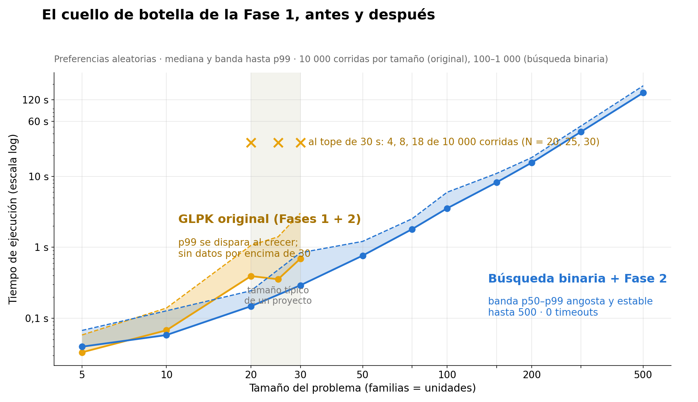

```{=openxml}
<w:p><w:r><w:br w:type="page"/></w:r></w:p>
```

# El sorteo {#cap-sorteo}

*Este capítulo trata en profundidad el sorteo: el problema de asignación que resuelve, sus garantías, la formulación matemática, la mejora de rendimiento que constituye el aporte original de este trabajo, los resultados empíricos y la mecánica de ejecución. Es el capítulo más técnico del documento; un lector con formación en investigación de operaciones encontrará aquí el núcleo matemático, mientras que los detalles de implementación de más bajo nivel se remiten a los apéndices.*


## El problema de asignación y el modelo de preferencias {#sec-problema-asignacion}

El sorteo resuelve un **problema de asignación**: distribuir un conjunto de viviendas entre un conjunto de familias, respetando las preferencias que cada familia expresa sobre las viviendas.

**Preferencias.** Cada familia ordena las unidades de su tipo de la más deseada a la menos deseada. Ese orden se representa como un **rango**: para una familia $c$ y una unidad $v$, el valor $p_{c,v}$ es la posición que $v$ ocupa en la lista de $c$, donde $p_{c,v}=1$ indica la primera opción. Un rango menor es mejor. La lista de cada familia es **completa y total** sobre las unidades de su tipo: aunque un cooperativista solo ordene explícitamente algunas unidades, el sistema completa el resto para que toda unidad del tipo tenga un rango asignado (la resolución dinámica de esta lista se describe en la Sección @sec-ejecucion). De este modo, el dato de entrada del algoritmo es, para cada familia, una permutación de las unidades de su tipo.

**Descomposición por tipo de vivienda.** Como se explicó en el Capítulo @cap-funcional, cada familia opta únicamente por unidades de su tipo. Por lo tanto, el sorteo de un proyecto **no es un único problema**, sino una colección de subproblemas independientes, uno por cada tipo de vivienda: las familias de un tipo compiten entre sí por las unidades de ese tipo. La solución global se compone de las soluciones de cada subproblema, más una fase de redistribución de remanentes para los casos en que un subproblema queda desbalanceado (§@sec-ejecucion).

**Caso balanceado y desbalanceado.** El núcleo del algoritmo se formula sobre el **caso balanceado**, en el que el número de familias es igual al número de unidades del tipo ($|C| = |V|$): cada familia recibe exactamente una unidad y cada unidad se asigna a exactamente una familia. Los casos desbalanceados —más familias que unidades, o más unidades que familias— se reducen al caso balanceado mediante selección de unidades y redistribución de remanentes, que se tratan en §@sec-ejecucion. La formulación que sigue asume el caso balanceado.


## Qué garantiza el algoritmo: equidad max-min y satisfacción global {#sec-garantias}

El algoritmo persigue dos objetivos, en **orden de prioridad estricta**: primero la equidad, y solo después la satisfacción global.

**Equidad (max-min).** El primer objetivo es proteger a la familia peor tratada. En lugar de maximizar un promedio —que podría dejar a una familia con un resultado pésimo mientras el resto queda muy conforme—, se minimiza el **peor rango** que recibe cualquier familia. Es el criterio de **equidad max-min**: se busca la asignación en la que la familia menos favorecida quede lo mejor posible. Esto acota, para todas las familias por igual, cuán mala puede ser una asignación individual.

**Satisfacción global.** Fijada esa cota de equidad, puede haber muchas asignaciones distintas que la respeten. Entre todas ellas, el segundo objetivo elige la que **maximiza la satisfacción del conjunto**: minimiza la suma de los rangos asignados (equivalentemente, otorga la mayor cantidad de primeras opciones posibles, luego segundas, y así sucesivamente). La satisfacción global nunca se persigue a costa de la equidad ya garantizada.

**Propiedades.** El resultado de este esquema tiene propiedades deseables, analizadas formalmente desde la teoría del diseño de mercados: es **eficiente en el sentido de Pareto** —no existe otra asignación que mejore a una familia sin perjudicar a otra— y trata **por igual a quienes son iguales** —dos familias con idénticas preferencias tienen la misma probabilidad ante un empate, que se resuelve al azar— (véase §@sec-mtav-original). La formalización de estos dos objetivos es el contenido de la sección siguiente.

::: nuevo
**El desempate en la implementación.** La plataforma no alcanza todavía esa última propiedad. El generador de datos suma a los rangos de cada familia una cantidad aleatoria pensada como desempate, pero es a lo sumo 0,0001 y los rangos se escriben con tres decimales, de modo que nunca llega al solver; y aun sin redondeo no desempataría, porque es una misma constante para todos los rangos de una familia, y como cada familia recibe exactamente una unidad, toda asignación se desplaza en el mismo total. GLPK es determinista, de modo que entre asignaciones igualmente óptimas decide el orden en que las familias y las unidades llegan al modelo: el orden de los datos. Dos familias con idénticas preferencias obtienen, por tanto, siempre el mismo resultado, y repetir el sorteo lo repite. El sorteo aleatorio de los empates —una semilla por ejecución, registrada en la auditoría para que el resultado siga siendo reproducible— queda como trabajo futuro (§@sec-tf-algoritmo). [Nov. 2026: estado real del desempate]{.rev #rev-n-desempate-3}
:::


## Formulación matemática {#sec-formulacion}

El problema se modela como un problema de **programación lineal entera** (con variables binarias de asignación), resuelto en dos fases encadenadas. Se presentan a continuación ambos modelos; los archivos de modelo completos en lenguaje GMPL (GNU MathProg) están en el Apéndice C.

**Conjuntos y parámetros.**

- $C$: conjunto de familias; $V$: conjunto de unidades; en el caso balanceado $|C| = |V| = N$.
- $p_{c,v} \in \{1, \dots, N\}$: rango que la familia $c \in C$ asigna a la unidad $v \in V$ (menor es mejor).

**Variables de decisión.**

- $x_{c,v} \in \{0, 1\}$: vale $1$ si la unidad $v$ se asigna a la familia $c$, y $0$ en caso contrario.

**Restricciones de asignación.** Ambas fases comparten las restricciones que definen una asignación uno a uno (un emparejamiento perfecto entre familias y unidades):

$$\sum_{v \in V} x_{c,v} = 1 \quad \forall c \in C \qquad\text{(cada familia recibe exactamente una unidad)}$$

$$\sum_{c \in C} x_{c,v} = 1 \quad \forall v \in V \qquad\text{(cada unidad se asigna a exactamente una familia)}$$

**Fase 1 — Equidad max-min.** Se introduce una variable $z \in \mathbb{Z}$ que representa el peor rango recibido por alguna familia, y se minimiza:

$$\min\ z \qquad\text{sujeto a}\qquad z \ge \sum_{v \in V} p_{c,v}\, x_{c,v} \quad \forall c \in C,$$

junto con las restricciones de asignación. En el óptimo, $z$ iguala al máximo de los rangos asignados, de modo que su valor mínimo $S^\ast = z^\ast$ es el menor "peor rango" alcanzable: ninguna asignación puede lograr que la familia peor tratada quede mejor que $S^\ast$.

**Fase 2 — Satisfacción global.** Con la cota de equidad $S = S^\ast$ obtenida en la Fase 1, se minimiza la suma total de rangos, restringiendo que ninguna familia supere esa cota:

$$\min\ \sum_{c \in C} \sum_{v \in V} p_{c,v}\, x_{c,v} \qquad\text{sujeto a}\qquad \sum_{v \in V} p_{c,v}\, x_{c,v} \le S \quad \forall c \in C,$$

junto con las restricciones de asignación. El resultado es la asignación de máxima satisfacción agregada entre todas las que respetan la equidad de la Fase 1.

En conjunto, las dos fases implementan una **optimización lexicográfica**: se optimiza primero el criterio de equidad y, dentro del conjunto de soluciones que lo alcanzan, el de satisfacción global. Esta formulación es la desarrollada en el trabajo previo sobre MTAV (§@sec-antecedentes) y es la que MTAV en línea implementa fielmente. La mejora que introduce este trabajo no cambia el modelo, sino la forma de resolver la Fase 1, como se explica a continuación.


## El cuello de botella de la Fase 1: casos degenerados {#sec-cuello-fase1}

La solución original —la misma que utiliza la herramienta de escritorio (§@sec-antecedentes)— resuelve ambas fases con GLPK. La Fase 2, dada la cota $S$, resulta rápida y estable en todos los casos observados: la restricción $\sum_v p_{c,v} x_{c,v} \le S$ acota fuertemente el espacio de búsqueda. El problema está en la **Fase 1**: minimizar $z$ mediante *branch-and-bound* puede volverse extremadamente lento —o no terminar en tiempo razonable— sobre instancias **degeneradas**.

Una instancia es degenerada cuando existen muchas asignaciones distintas que alcanzan el mismo valor óptimo de $z$. Dos casos extremos lo ilustran:

- **Preferencias idénticas:** todas las familias ordenan las unidades de la misma manera. Cualquier permutación de la asignación produce exactamente el mismo multiconjunto de rangos, de modo que hay un número factorial de soluciones óptimas equivalentes. Aunque el valor óptimo es evidente, el solver debe recorrer una enorme cantidad de ramas simétricas para *demostrar* que no existe una mejor.
- **Preferencias opuestas:** familias con ordenamientos espejados generan una simetría análoga.

El efecto es real y medible. En los *benchmarks* de la solución original [(escenario aleatorio)]{.quitado}[—en el escenario aleatorio, en el que cada familia ordena las unidades al azar, de forma independiente de las demás—]{.nuevo} aparecen los primeros *timeouts* ya en tamaños de **25 a 30 familias**: con un límite de 30 segundos, en tamaño 30, 48 de cada 10 000 ejecuciones no terminaron dentro del límite, y una instancia de tamaño 25, ejecutada sin límite de tiempo, llegó a tardar alrededor de **120 segundos**. Los casos degenerados (idénticas y opuestas) mostraron resultados mucho peores —intratables en la práctica—, al punto que no fue posible relevarlos sistemáticamente. Esta dificultad ya había sido documentada en el trabajo previo sobre MTAV, que recurría a imponer un límite de tiempo a la Fase 1 para evitar que el sistema se estancara (Fierro, 2024, §2.3). [Todas las mediciones se hicieron en un mismo equipo (procesador Intel Core i7-1195G7, 32 GB de RAM), dentro de contenedores Docker; la plataforma y la generación de cada escenario se describen en la Sección @sec-resultados.]{.nuevo} [#22: definición del escenario aleatorio y plataforma de las mediciones]{.rev #rev-22}

El diagnóstico es preciso: **el cuello de botella no es el problema de asignación en sí, sino la forma de resolver la Fase 1** —pedirle a GLPK que *minimice* $z$—. La Fase 2, que solo verifica una cota, no sufre esa degeneración. La mejora que se presenta a continuación explota exactamente esa asimetría.


## La búsqueda binaria: contribución original {#sec-busqueda-binaria}

La contribución algorítmica de este trabajo consiste en **no minimizar $z$ directamente**, sino en **buscar el menor valor de la cota $S$ para el cual el problema es factible**, usando la Fase 2 como prueba de factibilidad. Esto reemplaza la Fase 1 problemática por una serie corta de ejecuciones de la Fase 2, que es rápida y estable.

### La idea {#sec-bb-idea}

Para un valor $S$, considérese el predicado

$$F(S) = \text{«existe una asignación en la que toda familia recibe un rango} \le S\text{»}.$$

Verificar $F(S)$ es exactamente lo que hace la Fase 2 con cota $S$: si GLPK encuentra una asignación que respeta $\sum_v p_{c,v} x_{c,v} \le S$ para toda familia, entonces $F(S)$ es verdadero; si el modelo resulta infactible, $F(S)$ es falso. El óptimo max-min $S^\ast$ de la Fase 1 es, por definición, **el menor $S$ tal que $F(S)$ es verdadero**.

### Monotonía y corrección {#sec-bb-monotonia}

La búsqueda binaria es aplicable porque $F$ es **monótono** en $S$.

**Proposición.** Si $F(S)$ es verdadero, entonces $F(S+1)$ también lo es. Equivalentemente, si $F(S)$ es falso, $F(S-1)$ también lo es.

**Demostración.** Si existe una asignación en la que toda familia recibe un rango $\le S$, esa misma asignación cumple que toda familia recibe un rango $\le S+1$, ya que $S \le S+1$; por lo tanto $F(S+1)$ es verdadero. La forma contrapositiva es inmediata. $\qquad\blacksquare$

En consecuencia, el conjunto de valores factibles forma un **intervalo superior** $\{S : F(S)\} = [S^\ast, N]$, y el de los infactibles, el intervalo $[1, S^\ast - 1]$ (posiblemente vacío, si toda familia puede recibir su primera opción). Es decir, el espacio de valores de $S$ queda **partido en dos** por el umbral $S^\ast$: infactible por debajo, factible a partir de $S^\ast$. Este es precisamente el escenario en que la búsqueda binaria localiza el umbral.

### El algoritmo {#sec-bb-algoritmo}

Se realiza una búsqueda binaria clásica sobre $S \in [1, N]$: en cada paso se toma el valor medio $S$ del intervalo de búsqueda y se resuelve la Fase 2 con esa cota. Si es factible, $S^\ast \le S$ y se continúa en la mitad inferior; si es infactible, $S^\ast > S$ y se continúa en la mitad superior. El procedimiento converge al umbral $S^\ast$ en $O(\log N)$ pruebas de factibilidad.

Un detalle valioso: como cada prueba de factibilidad **es** una ejecución de la Fase 2 —que, cuando es factible, devuelve una asignación concreta—, la última prueba factible (la de $S = S^\ast$) entrega a la vez la **cota óptima de equidad y una asignación que la alcanza**. Las dos fases del método original se funden así en una sola búsqueda.

### Equivalencia con el método original {#sec-bb-equivalencia}

La búsqueda binaria produce **el mismo resultado** que la Fase 1 original, por dos vías complementarias:

- **Argumento teórico.** Por la monotonía de $F$, el menor $S$ factible hallado por la búsqueda es exactamente $S^\ast$, el óptimo max-min que minimiza $z$ en la Fase 1. Fijado ese $S^\ast$, la Fase 2 —idéntica en ambos métodos— optimiza la satisfacción global. Ambos caminos conducen, por tanto, al mismo par (cota de equidad, asignación).
- **Verificación empírica.** La Fase 1 original con GLPK se conserva en el código como referencia; una prueba de estrés ejecuta *ambos* métodos sobre las instancias históricamente problemáticas (las que tardaban desde 5 hasta más de 120 segundos con GLPK directo) y verifica que el $S$ hallado coincide exactamente.

Cabe subrayar el alcance de la contribución: **no se modifica el modelo ni la Fase 2**, que sigue resolviéndose con GLPK. Solo cambia la manera de resolver la Fase 1. El resultado es matemáticamente equivalente al método original, ya validado por su uso en proyectos cooperativos reales (§@sec-validacion), pero elimina su único punto de fragilidad.


## Resultados empíricos {#sec-resultados}

[Para cuantificar la mejora se ejecutaron *benchmarks* sobre cuatro escenarios de preferencias —**aleatorias**, **realistas** (mezcla de unidades populares e impopulares, que simula el comportamiento real), **idénticas** y **opuestas** (los dos casos degenerados)— en tamaños de 5 a 500 familias, con cientos a miles de repeticiones por configuración.]{.quitado}

::: cambio
Para cuantificar la mejora se ejecutaron *benchmarks* sobre instancias generadas artificialmente: $N$ familias y $N$ unidades, con $N$ entre 5 y 500, y un ordenamiento completo de las unidades para cada familia. Cada combinación de escenario y tamaño se repitió entre 100 y 1 000 veces (10 000 para la solución original), con preferencias nuevas en cada repetición. Los cuatro escenarios de preferencias son: [#23: cómo se generan los escenarios y en qué plataforma se midió; el detalle completo queda en el Apéndice C.3]{.rev #rev-23}

- **Aleatorias:** cada familia ordena las unidades al azar —una permutación uniforme—, de forma independiente de las demás.
- **Realistas:** cada familia favorece algunas unidades y desfavorece otras: un 20 % de las unidades tiende a quedar al principio de su ordenamiento, otro 20 % al final, y el resto en el medio. Qué unidades favorece o desfavorece se sortea por separado para cada familia, de modo que no hay unidades preferidas por el conjunto.
- **Idénticas:** todas las familias ordenan las unidades exactamente igual; es el peor caso para el desempate.
- **Opuestas:** se fija un único orden de las unidades; la mitad de las familias lo adopta tal cual y la otra mitad, exactamente invertido.

Idénticas y opuestas son los dos casos degenerados descritos en la Sección @sec-cuello-fase1. La generación exacta de cada escenario se detalla en el Apéndice C.3.

**Plataforma.** Todas las corridas se ejecutaron en un mismo equipo —procesador Intel Core i7-1195G7 (4 núcleos y 8 hilos, hasta 5,0 GHz) y 32 GB de RAM—, con la aplicación dentro de contenedores Docker (PHP 8.4 sobre Alpine Linux, con GLPK 5.0) y sin límites de CPU ni de memoria. GLPK resuelve cada problema en un único proceso, sin paralelizar. El tiempo medido es el tiempo de reloj de la resolución completa —ambas fases—, desde que se invoca el solver hasta que devuelve la asignación.
:::

**Solución original (GLPK en ambas fases).** Como se detalló en §@sec-cuello-fase1, los *timeouts* aparecen ya en tamaños de 25 a 30 familias en el escenario aleatorio, y los escenarios degenerados resultan intratables.

**Con búsqueda binaria.** El método propuesto resuelve **el 100 % de las instancias, sin un solo *timeout***, en los cuatro escenarios y en todos los tamaños hasta 500 familias —incluidos los casos idénticos y opuestos que la solución original no podía terminar—. Los tiempos medios de ejecución (resolución completa) son:

| Escenario | $N=75$ | $N=150$ | $N=300$ | $N=500$ |
|---|---|---|---|---|
| Aleatorias | 0,7 s | 2,8 s | 28 s | 56 s |
| Realistas | 1,3 s | 4,4 s | 16 s | 75 s |
| Idénticas | 1,5 s | 6,2 s | 25 s | 88 s |
| Opuestas | 1,2 s | 4,6 s | 19 s | 85 s |

Dos lecturas importantes de estos números:

- **El cuello de botella desapareció.** Instancias que antes no terminaban —tanto las degeneradas como las aleatorias por encima de unas pocas decenas de familias— hoy se resuelven de forma confiable. El caso de preferencias idénticas, el peor posible para el desempate, se resuelve al 100 % incluso a tamaño 500.
- **El tiempo restante es de la Fase 2, no de la Fase 1.** El crecimiento del tiempo con el tamaño se debe a la optimización de asignación en sí (la Fase 2 con GLPK), no a la degeneración que la búsqueda binaria eliminó. Además, estos tamaños corresponden a un sorteo por tipo de unidad: un proyecto real se reparte en varios tipos, cada uno con su propio subproblema más pequeño, y las cooperativas reales están muy por debajo de las 500 unidades. En la práctica, el sorteo se resuelve en el rango de fracciones de segundo a pocos segundos.

La figura siguiente resume la comparación en el escenario aleatorio —el único en que la solución original produce datos comparables; en los degenerados directamente no terminaba—. La banda de cada serie va de la mediana al percentil 99: la del método original se dispara precisamente en el rango de tamaños de un proyecto real, mientras que la de la búsqueda binaria se mantiene angosta y estable hasta tamaño 500.



El detalle por escenario —incluidos los casos degenerados que la solución original no podía resolver— y las estadísticas completas (percentiles, tasas de éxito, metodología) se presentan en el Apéndice C.3.


## Ejecución, orquestación por tipos y redistribución de remanentes {#sec-ejecucion}

Hasta aquí, la formulación asumió el caso balanceado (igual número de familias y unidades) y un único tipo de vivienda. La ejecución real de un sorteo de proyecto compone esos subproblemas y resuelve los desbalances.

**Orquestación por tipos.** Siguiendo la descomposición establecida en §@sec-problema-asignacion, el sorteo se ejecuta como una colección de subproblemas independientes, uno por tipo de vivienda, cada uno resuelto con el método de las secciones anteriores. [El motor no conoce familias ni viviendas: resuelve **participantes** e **ítems**, en **grupos**; que los participantes sean familias, los ítems unidades y los grupos tipos de vivienda es la traducción que hace el servicio del sorteo del proyecto (Sección @sec-capa-sorteo).]{.nuevo} [Nov. 2026: el motor se generalizó]{.rev #rev-n-orquestacion}

**Balanceo de subproblemas desbalanceados.** Cuando un subproblema no tiene igual número de familias que de unidades, se lo reduce al caso balanceado antes de resolverlo:

- **Sobran unidades** (más unidades que familias): se descartan las "peores" unidades hasta igualar la cantidad de familias. El descarte es en dos pasos[, preservando la equidad max-min]{.quitado}: primero una poda heurística que retiene las unidades que aparecen en las mejores posiciones de las preferencias de las familias, y —si aún quedan de más— un modelo GLPK de selección de unidades que elige cuáles conservar de modo de minimizar el peor rango resultante. [La poda, sin embargo, no preserva la equidad max-min: el conjunto de unidades que ocupan los primeros $d$ lugares de alguna familia solo prueba que el peor rango óptimo es al menos $d$, y el óptimo puede necesitar una unidad fuera de ese conjunto, de modo que una familia puede recibir su cuarta opción donde la tercera era alcanzable.]{.nuevo} [Nov. 2026: límite de la poda]{.rev #rev-n-poda}
- **Faltan unidades** (más familias que unidades): se agregan **unidades ficticias**, que todas las familias ordenan en último lugar. Así, el propio algoritmo decide qué familias quedan sin unidad real en esta ronda (las que resulten asignadas a una unidad ficticia), en lugar de excluirlas arbitrariamente. [Pero como alguna familia recibe siempre la última unidad ficticia, la cota de la Fase 1 vale siempre $n + k$ —mayor que cualquier rango real— y la Fase 2 solo minimiza la suma de los rangos: en estos casos la garantía max-min no opera, y quién queda sin unidad lo decide la suma, no un sorteo.]{.nuevo}

**Redistribución de remanentes.** Las familias que quedaron sin unidad y las unidades que quedaron sin familia se acumulan como *remanentes* de las rondas por tipo. Una segunda pasada ejecuta un sorteo sobre esos remanentes, dándoles una nueva oportunidad de asignación en lugar de descartarlos[; en ella toda unidad remanente vale lo mismo para toda familia remanente, de modo que la asignación es un empate puro, y la decide el orden de los datos (§@sec-garantias)]{.nuevo}.

[Las dos limitaciones anteriores se circunscriben a los tipos desbalanceados: en un tipo con tantas familias como unidades, la formulación de §@sec-formulacion se aplica sin reducción alguna y las garantías valen por completo. Resolver el caso desbalanceado como una asignación rectangular —cada unidad a lo sumo a una familia, cada familia una unidad o ninguna, sin poda previa ni unidades ficticias— queda como trabajo futuro (§@sec-tf-algoritmo).]{.nuevo}

**Estrategias de solver.** El solver es intercambiable detrás de una interfaz común; el diseño de esa capa se describe en la Sección @sec-capa-sorteo.


## Inmutabilidad y auditoría {#sec-auditoria}

[Sección reescrita (noviembre de 2026): cada ejecución es un registro con estados, se resuelve en segundo plano y se revela a todos a la vez; la invalidación es de los administradores; el acta y su huella]{.rev #rev-n-auditoria}

El sorteo es una instancia **única y sensible**: define dónde vivirá cada familia y no se repite. Por eso su ejecución está rodeada de garantías de integridad.

**Ejecución y bloqueo.** Cada ejecución es un registro propio (`lottery_runs`), con estado: *en curso*, *completada*, *fallida* o *invalidada*. Cuando el administrador ejecuta el sorteo, en una sola transacción y con el proyecto retenido —ningún cambio en familias, tipos, unidades o preferencias puede colarse mientras tanto—, el sistema comprueba que el sorteo puede correr (está agendado y llegó su fecha, no hay otra ejecución activa, hay un trabajador de cola vivo, hay al menos dos familias, y el administrador confirmó los tipos cuyas familias y unidades no coinciden en número), escribe la ejecución como en curso y registra el **manifiesto**: el ranking completo de cada familia, por tipo, tal como está en ese instante. A partir de ahí las preferencias quedan bloqueadas, mientras una ejecución esté en curso o completada; un ranking enviado en el mismo momento espera la retención y queda en el manifiesto, o es rechazado. La resolución la hace un trabajo en cola, sobre el manifiesto registrado y nunca sobre lo que el proyecto tenga después. La asignación encontrada **se retiene** hasta el momento de revelarla, fijado al lanzar la ejecución según el tiempo mínimo que establece la superadministración (veinte segundos por defecto): entonces se escriben todas las unidades a la vez, en una transacción, y la ejecución pasa a completada; el tiempo cambia cuándo se ve el resultado, nunca cuál es. Al completarse, se emiten eventos que disparan las notificaciones y la difusión en tiempo real (§@sec-notificaciones). Si la ejecución falla, se cierra como fallida —no decidió nada—, el administrador es avisado y el sorteo puede volver a ejecutarse.

**Inmutabilidad.** Una vez ejecutado, el resultado es **definitivo**: no se edita ni se renegocia. Esta inmutabilidad es una exigencia del dominio —legal y social—, no una limitación técnica. La única excepción es la **invalidación**, reservada para situaciones excepcionales (por ejemplo, un error de datos detectado después): un administrador invalida una ejecución completada dando un motivo, de diez a mil caracteres, que todo el proyecto ve —quién, cuándo y por qué— y recibe como notificación. Invalidar libera todas las unidades y cierra la ejecución como invalidada; el sorteo puede repetirse, como una ejecución nueva con su propio registro. Dos invalidaciones enviadas a la vez ocurren una sola vez.

**Registro de auditoría.** Cada ejecución genera un conjunto de registros de auditoría, asociados a ella, que se escriben a medida que ocurre cada paso y nunca se modifican. Los tipos de registro distinguen los momentos del proceso: `INIT` (inicio, con el manifiesto), `CUSTOM` (pasos auxiliares, como la resolución del solver con sus artefactos), `GROUP_EXECUTION` (uno por cada sorteo de tipo de unidad), `PROJECT_EXECUTION` (finalización del proyecto), `INVALIDATE` (reversión por un administrador) y `FAILURE` (error de ejecución). El registro dura lo que dura el proyecto. Al conservar tanto las preferencias consideradas como el resultado producido, este registro constituye evidencia **no repudiable**: cualquiera puede verificar, después del hecho, que la asignación se corresponde con las preferencias ingresadas.

**El acta.** Del registro se deriva el **acta** de cada ejecución, que cualquier integrante del proyecto lee: cada familia con la unidad que recibió y el lugar de esa unidad en el ranking de la familia, tal como quedó registrado; el peor lugar y el promedio; y la **huella** del acta, el SHA-256 del manifiesto y del resultado tal como están almacenados, que cambia si cualquiera de los dos cambiara. Cada familia ve allí su propio ranking completo; nadie ve el de otra. Los administradores descargan la traza entera en JSON. El esquema y un ejemplo anotado del registro se incluyen en el Apéndice C.

El mismo ciclo —inicio con el manifiesto registrado, resolución en segundo plano, retención, publicación o fallo— sirve a cualquier **anfitrión** del sorteo: el de un proyecto de MTAV y el de un sorteo abierto de la variante Open Lottery (Sección @sec-variantes).

